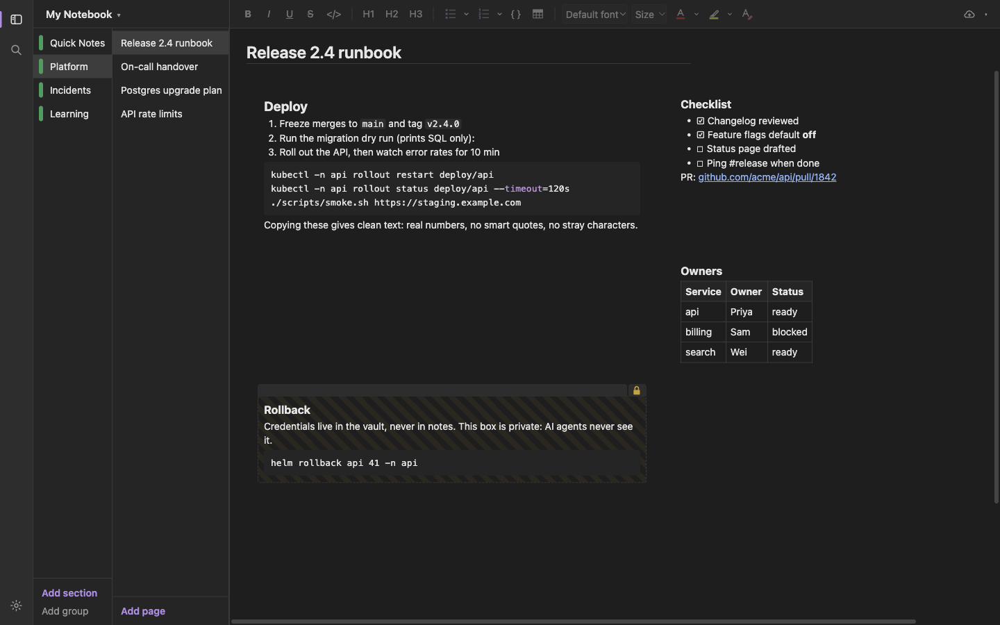
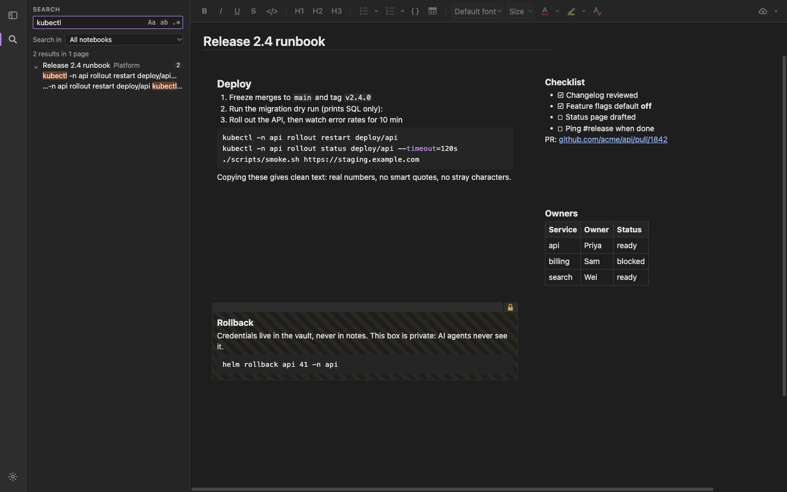
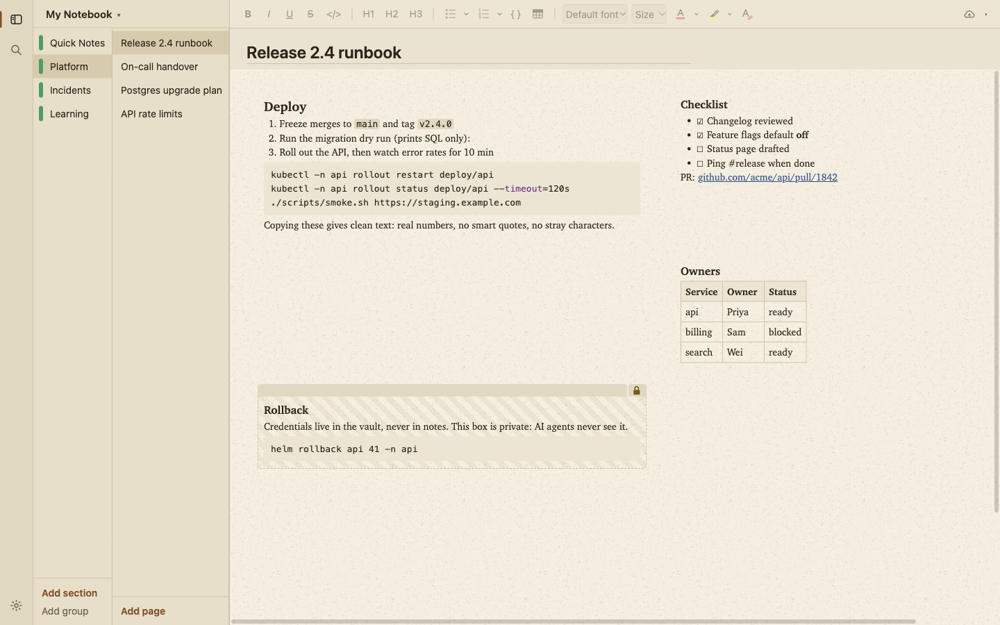
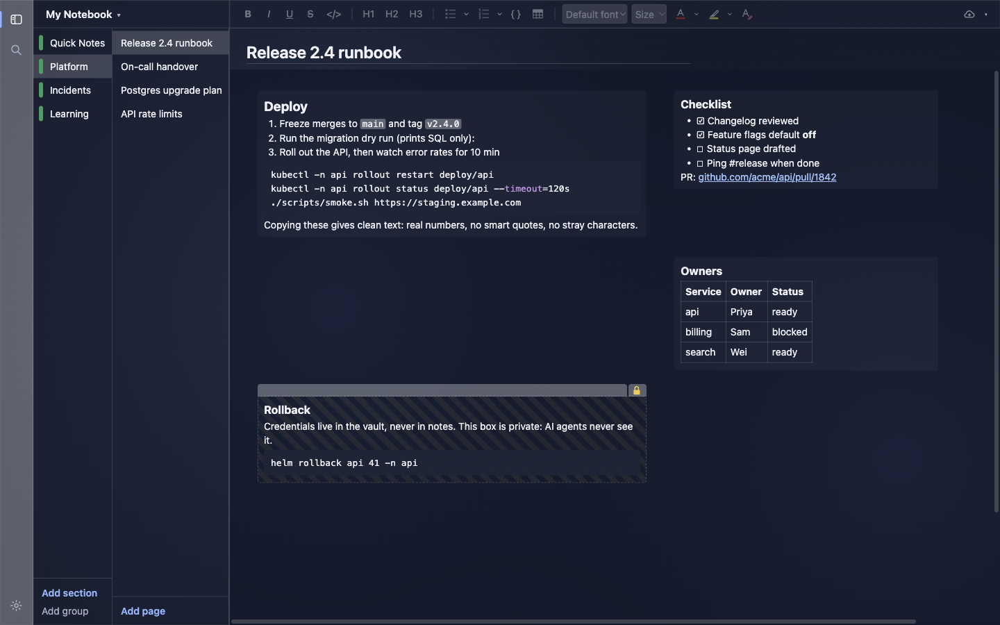
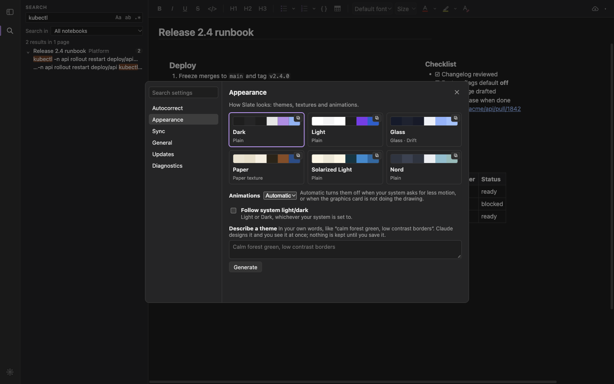

# Slate

**Fast, free-form notes for developers leaving OneNote.** Boxes you can put anywhere on the page,
sections and pages, images, and real formatting, like OneNote. Copying is clean, nothing
auto-formats behind your back, it works offline, it syncs through your own git repository, and AI
agents can read your notes with your permission.



## Why switch from OneNote

| In OneNote | In Slate |
| --- | --- |
| Slow on Ubuntu, and Linux is an afterthought | A native app for macOS and Ubuntu (`.deb`/AppImage). On a laptop, typing stays under 16 ms a key and a 200-box page opens in under 100 ms; CI measures both on Ubuntu for every change |
| Copy a command into a terminal and get smart quotes, odd spaces and invisible characters | **Copy gives clean text**: straight quotes, real list numbers, code exactly as written, no zero-width or non-breaking characters |
| Paste brings the source's fonts, sizes and colours with it | Paste keeps the structure and bold or italic, and drops the rest. Cmd/Ctrl+Shift+V pastes plain text |
| Auto-numbering and auto-formatting you didn't ask for | Nothing changes as you type, except one thing you can switch off: `* ` and a space starts a bulleted list (Settings → Autocorrect) |
| AI tools can't see your notes, or see all of them | A built-in [MCP server](#ai-access): agents such as Claude Code read and write only the sections you share, and a **private** box (the padlock) is never sent to them |
| Sync only through a Microsoft account | **Git sync** to your own private repository (SSH, a token or `gh`), or OneDrive. Offline first; edits made in two places merge, and real conflicts are shown to you |
| Your notes are stuck in OneNote | **Import** sections from OneNote's backup files (no Microsoft account needed) or from OneNote online (with your own Azure app id) |

## Features

- **Free-form pages.** Click anywhere to place the caret and start typing. A box appears there.
  Drag and resize boxes; a box that grows pushes the ones below it down.
- **Formatting.** Headings, bold, italic, underline, strikethrough, inline code, code blocks with
  syntax colouring, tables, and bulleted and numbered lists (1. a. i. A. I.). OneNote-style colour
  and highlighter palettes. Cmd/Ctrl+K adds a link, and pasting a URL onto selected text links it.
- **Find in page** (Cmd/Ctrl+F) and **search across notes** (Cmd/Ctrl+Shift+F), VS Code style, with
  match case, whole word and regular expressions. Search covers all notebooks, one notebook or a
  single section, and remembers your choice.

  

- **Themes.** Dark, Light, Glass, Paper (with a real paper texture), Solarized Light and Nord. Or
  describe one and let Claude design it, if you have the `claude` CLI. Animations can be turned
  off. Text from imported notes is always drawn readable on the theme's background.

  | Paper | Glass |
  | --- | --- |
  |  |  |

  

- **Settings** (Cmd/Ctrl+,): Autocorrect, Appearance, Sync, General, Updates and Diagnostics.
- **Sync status at a glance.** The cloud button at the top right shows when you last synced; a
  click syncs now.
- **Diagnostics you control.** An opt-in log (Settings → Diagnostics) that records what the app
  did, never what you wrote, ready to attach to a bug report.

## Install

Download the latest build from [Releases](https://github.com/nuwanprabhath/slate/releases).

### macOS (Apple Silicon)

1. Download `Slate-<version>-mac-arm64.dmg`, open it and drag Slate to Applications.
2. Slate is not signed with an Apple Developer ID, so macOS blocks the first launch
   ("Slate is damaged" or "cannot be opened"). Either clear the quarantine flag:

   ```bash
   xattr -cr /Applications/Slate.app
   ```

   or right-click Slate in Applications, choose **Open**, then **Open** again. You only do this once
   per install.

Intel Macs: build from source with `npm run dist:mac:x64`.

### Ubuntu / Debian (x64)

```bash
sudo apt install ./Slate-<version>-linux-amd64.deb
```

Use `apt` with the `./` path (not `dpkg -i`) so dependencies are installed. The `.AppImage` also
works: `chmod +x Slate-*.AppImage` and run it.

### Windows

No release builds yet. Build from source: `npm install`, `npm run build:one2html`, then `npm run dist`.

## Updates

Slate checks GitHub Releases shortly after launch and then every few hours (Settings → Updates sets
how often, or turns automatic checks off). **Check for Updates…** is in the Slate menu on macOS and
under Help on Linux. When a newer version exists, a banner across the top of the window offers it.
It never interrupts with a dialog, and a failed check stays silent.

- **AppImage**: *Download and install*, then *Restart and install*.
- **macOS**: *Download* fetches the dmg, verifies it and opens it. Drag Slate to Applications, or use
  *Copy install command*, paste it into Terminal after quitting Slate (it copies the app out of the
  dmg and clears the quarantine flag).
- **.deb**: *Download* fetches the `.deb`; *Copy install command* gives
  `sudo apt install '<path to the .deb>'` to run in a terminal.

*Skip this version* hides that version until you choose *Stop skipping* in Settings → Updates; the
× hides the banner until the next version.

## AI access

Slate ships an MCP server so AI agents such as Claude Code can read and write your notes. Build first
(`npm run build -w @slate/desktop`), then register it:

```bash
claude mcp add slate -- $PWD/bin/slate-mcp
```

Nothing is shared until you grant access in the sidebar (right-click → AI access). Private boxes are
never sent to an agent, and every agent read and write is listed in View → AI Activity.

## Develop

```bash
npm install        # also rebuilds better-sqlite3 for Electron
npm run dev        # run the app with hot reload
npm test           # unit tests (core, editor, renderer helpers)
npm run test:main  # main-process tests (SQLite, sync, search, updates) under Electron's Node
npm run e2e        # build + Playwright end-to-end tests (the window stays hidden)
npm run typecheck
```

The README screenshots come from a dummy notebook:
`npm run build -w @slate/desktop && npm run screenshots -w @slate/desktop`.

Design notes are in `docs/superpowers/specs/2026-10-21-slate-design.md`. The left bar's views are
plugins (`packages/desktop/src/renderer/src/plugins/README.md`).

## Licence

MIT
