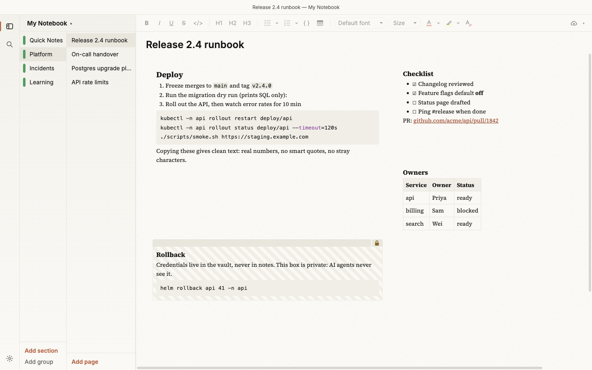

# Slate

**Fast, free-form notes for developers leaving OneNote.** Boxes you can put anywhere on the page,
sections and pages, images, and real formatting, like OneNote. Copying is clean, nothing
auto-formats behind your back, it works offline, it syncs through your own git repository, and AI
agents can read your notes with your permission.


## Why switch from OneNote

| In OneNote | In Slate |
| --- | --- |
| Slow on Ubuntu, and Linux is an afterthought | A native app for macOS and Ubuntu (`.deb`/AppImage). On a laptop, typing stays under 16 ms a key and a 200-box page opens in under 100 ms; CI measures both on Ubuntu for every change |
| Copy a command into a terminal and get smart quotes, odd spaces and invisible characters | **Copy gives clean text**: straight quotes, real list numbers, code exactly as written, no zero-width or non-breaking characters |
| Paste brings the source's fonts, sizes and colours with it | Paste keeps the structure and bold or italic, and drops the rest. Cmd/Ctrl+Shift+V pastes plain text |
| Auto-numbering and auto-formatting you didn't ask for | Nothing changes as you type, except one thing you can switch off: `* ` and a space starts a bulleted list (Settings → Autocorrect) |
| AI tools can't see your notes, or see all of them | A built-in [MCP server](#ai-access): agents such as Claude Code read and write only the sections you share, and a **private** box (the padlock) is never sent to them |
| Sync only through a Microsoft account | **Git sync** to your own private repository (SSH, a token or `gh`), or OneDrive. Offline first; edits made in two places merge, and real conflicts are shown to you |
| Your notes are stuck in OneNote | **Import** sections from OneNote's backup files (no Microsoft account needed) or from OneNote online (with your own Azure app id) |

## Features

- **Free-form pages.** Click anywhere to place the caret and start typing. A box appears there.
  Drag and resize boxes; a box that grows pushes the ones below it down.
- **Formatting.** Headings, bold, italic, underline, strikethrough, inline code, code blocks with
  syntax colouring, tables, and bulleted and numbered lists (1. a. i. A. I.). OneNote-style colour
  and highlighter palettes. Cmd/Ctrl+K adds a link, and pasting a URL onto selected text links it.
- **Find in page** (Cmd/Ctrl+F) and **search across notes** (Cmd/Ctrl+Shift+F), VS Code style, with
  match case, whole word and regular expressions. Search covers all notebooks, one notebook or a
  single section, and remembers your choice.

  

- **Themes.** Dark, Light, Liquid Glass, Paper (with a real paper texture), Folio, Folio Dark, Solarized Light and Nord. Or
  describe one and let Claude design it, if you have the `claude` CLI. Animations can be turned
  off. Text from imported notes is always drawn readable on the theme's background.

  | Paper | Liquid Glass | Folio |
  | --- | --- | --- |
  |  |  |  |

  

- **Settings** (Cmd/Ctrl+,): Autocorrect, Appearance, Sync, General, Updates and Diagnostics.
- **Sync status at a glance.** The cloud button at the top right shows when you last synced; a
  click syncs now.
- **Diagnostics you control.** An opt-in log (Settings → Diagnostics) that records what the app
  did, never what you wrote, ready to attach to a bug report.

## Install

Download the latest build from [Releases](https://github.com/nuwanprabhath/slate/releases).

### macOS (Apple Silicon)

1. Download `Slate-<version>-mac-arm64.dmg`, open it and drag Slate to Applications.
2. Slate is not signed with an Apple Developer ID, so macOS blocks the first launch
   ("Slate is damaged" or "cannot be opened"). Either clear the quarantine flag:

   ```bash
   xattr -cr /Applications/Slate.app
   ```

   or right-click Slate in Applications, choose **Open**, then **Open** again. You only do this once
   per install.

Intel Macs: build from source with `npm run dist:mac:x64`.

### Ubuntu / Debian (x64)

```bash
sudo apt install ./Slate-<version>-linux-amd64.deb
```

Use `apt` with the `./` path (not `dpkg -i`) so dependencies are installed. The `.AppImage` also
works: `chmod +x Slate-*.AppImage` and run it.

### Windows

No release builds yet. Build from source: `npm install`, `npm run build:one2html`, then `npm run dist`.

## Updates

Slate checks GitHub Releases shortly after launch and then every few hours (Settings → Updates sets
how often, or turns automatic checks off). **Check for Updates…** is in the Slate menu on macOS and
under Help on Linux. When a newer version exists, a banner across the top of the window offers it.
It never interrupts with a dialog, and a failed check stays silent.

- **AppImage**: *Download and install*, then *Restart and install*.
- **macOS**: *Download* fetches the dmg, verifies it and opens it. Drag Slate to Applications, or use
  *Copy install command*, paste it into Terminal after quitting Slate (it copies the app out of the
  dmg and clears the quarantine flag).
- **.deb**: *Download* fetches the `.deb`; *Copy install command* gives
  `sudo apt install '<path to the .deb>'` to run in a terminal.

*Skip this version* hides that version until you choose *Stop skipping* in Settings → Updates; the
× hides the banner until the next version.

## Upgrading to 0.2.0

Update **every device** before you encrypt, upgrade, rotate or convert a vault with 0.2.0: 0.1.x shows a
format-2 vault as damaged and can overwrite it when you change the password. Details are under
[Security and encryption](#security-and-encryption).

## AI access

Slate ships an MCP server so AI agents such as Claude Code can read and write your notes. Build first
(`npm run build -w @slate/desktop`), then register it:

```bash
claude mcp add slate -- $PWD/bin/slate-mcp
```

Nothing is shared until you grant access in the sidebar (right-click → AI access). Private boxes are
never sent to an agent, and every agent read and write is listed in View → AI Activity.

## Security and encryption

Encryption is off until you turn it on in Settings → Security → *Encrypt my notes…*. Design details:
[the encryption spec](docs/superpowers/specs/2026-10-23-e2ee-design.md).

- **What is encrypted**: your notes and images, on this computer and in the sync folder (git or
  OneDrive). A copy of a sync folder is unreadable without your password.
- **Password and recovery key**: you choose a password and get a recovery key, shown once. Either one
  opens your notes. Keep the recovery key somewhere safe outside Slate. **If you lose both, your notes
  are gone**: nobody, including the Slate developers, can recover them.
- **Quick unlock**: Touch ID on macOS, or the system keyring on Linux, can unlock Slate without
  typing the password. It is convenient but weaker: anyone who can use your logged-in account can
  open your notes with it. Turn it off in Settings → Security if that matters to you.
- **When Slate locks**: after 30 minutes without use (change it in Settings → Security), when the
  computer sleeps, when the screen locks, and from the menu or `Cmd/Ctrl+Shift+L`. On Linux, noticing
  a screen lock needs `gdbus` (part of GLib, installed on most desktops).
- **AI access** works only while Slate is open and unlocked. Locked, agents get a "Slate is locked"
  reply and nothing else.
- **Sync history**: encrypting with sync on replaces the sync folder's history with one encrypted
  commit, so old unencrypted versions leave the folder. Copies made elsewhere can still hold them:
  backups, other clones of the repository, and OneDrive's recycle bin and version history. Delete
  those yourself. Hosts such as GitHub keep the old commits reachable by their ID until their own
  garbage collection runs; for a full guarantee, sync to a new repository and delete the old one.
- **Changing the password or recovery key** stops the old one opening this computer's vault. Anyone
  holding an older copy of the vault files (a backup, the sync repository's history, OneDrive
  versions) and the old secret can still read the notes in that copy. To revoke an old secret fully,
  **rotate the keys** (below): that re-encrypts everything.
- **Rotating keys** (Settings → Security → *Rotate keys…*) makes a new master key and a new recovery
  key and re-encrypts your notes here and in the sync folder; your password stays the same. Other
  devices stop syncing until they are unlocked again with the password, then follow. Files sealed
  under the old keys are removed from the sync folder once everything was re-sent, and with git you
  are offered *Replace sync history…*, which leaves one commit of the current files (copies made
  elsewhere keep the old history; on OneDrive, empty the recycle bin). A FIPS 140-3 vault says when
  its keys are two years old and due for rotation; nothing rotates by itself.
- **Update every device first**: older versions of Slate cannot read encrypted notes. Other devices
  are asked for the password and then join.
- **Vaults made by this version (format 2)**: Slate 0.1.x cannot open them. It reports the sync
  folder's vault file as "damaged" and stops syncing, and, worse, if you change the password on a
  0.1.x device while the sync folder holds a format-2 vault, it writes its old-format vault file over
  the new one. **Update every device before you encrypt, upgrade or convert a vault, or rotate its
  keys**: Settings → Security offers these only once every device that syncs with the folder runs a
  version that reads format 2, and names the devices to update. Vaults made by 0.1.x keep working
  unchanged until you choose *Upgrade encryption format…*, which moves them to format 2 under new keys
  (the same password, a new recovery key).
- **FIPS 140-3 profile**: offered when you encrypt, in builds that ship the validated module. A
  standard vault can be converted later (Settings → Security → *Convert to FIPS 140-3…*, one way,
  with a new password of at least 15 characters and new keys); every other device then asks for the
  new password and follows. Otherwise the profile is fixed: a device whose notes are in a standard
  vault cannot join a different, FIPS 140-3 vault, or the other way round (export, then join from an
  unencrypted device). After opening a FIPS 140-3 vault, Slate must be restarted before
  it can open a standard one.
- **Keys in memory**: your keys stay inside Slate's cryptographic module, in locked memory that is
  wiped when Slate locks. The password and recovery key you type go to it as bytes and are wiped
  after use; the lock screen's window process ends once Slate unlocks, and Slate leaves no crash dump
  (on Linux other programs cannot read its memory either). On Linux the windows' own processes get that
  protection from Chromium's setuid sandbox, which the .deb installs and always uses. The AppImage cannot:
  on Ubuntu 23.10 and later it runs without Chromium's sandbox, and elsewhere in its user-namespace sandbox,
  where your own account's processes that may trace them can read them. Slate tells you on the lock screen and in
  Settings → Security when it runs without the sandbox; prefer the .deb. What cannot be wiped: the text field you
  typed into while its window lives, and a new password while you set
  it (it is checked against the password rules as text). On macOS, stopping other programs from reading Slate's memory needs a
  signed build, which this version is not.
- **Not protected**: malware running in your account while Slate is unlocked, and what the sync
  folder reveals anyway: how many files there are, their sizes, and when they change.

### What Slate claims about FIPS 140-3

Slate is **not** "FIPS 140-3 validated", and it is not "FedRAMP authorized". Only the cryptographic module it
embeds holds a certificate. This is the whole claim:

> In the `fips-140-3` profile, every cryptographic operation that protects notes is performed by the OpenSSL FIPS Provider 3.1.2 (CMVP certificate #4985, FIPS 140-3, active, sunset 2030-03-10) in its approved mode. Slate runs a power-up self-test, enters a terminal error state on any failure, and destroys key material at lock.

Where each part is tested (ids are in [`docs/compliance/traceability.yaml`](docs/compliance/traceability.yaml)):

- **Certificate #4985** is recorded in [`docs/compliance/crypto-module.json`](docs/compliance/crypto-module.json); the
  module's hash is pinned and checked at start (`POST-MODULE-STATUS`, T-POST-04, T-POST-06).
- **Approved mode, nothing else**: a `fips-140-3` vault never reaches Argon2id, HKDF or AES-ECB
  (`vault/fipsProfile.test.ts`, SCC_16 in `native/test/suite2.test.ts`, T-POL-05, T-POL-07).
- **Power-up self-test and terminal error state**: T-POST-01 to T-POST-13.
- **Keys destroyed at lock**: T-ZERO-01, T-ZERO-04, T-ZERO-05.
- **Stricter rules in the `fips-140-3` profile**: passwords of at least 15 characters, three wrong passwords in
  15 minutes lock password unlock for three hours, idle lock at most 15 minutes, no quick unlock.

- **Post-quantum**: your notes are encrypted with AES-256 only, which is not weakened to a usable degree by known
  quantum attacks. Git over SSH prefers a hybrid post-quantum key exchange where your `ssh` supports it, and
  Settings → Security shows what each sync connection actually negotiated. Updates carry an ML-DSA-65 + Ed25519
  signature, and both must verify. Neither the hybrid key exchange nor ML-DSA runs inside the validated module,
  and Microsoft and GitHub HTTPS were still classical when measured (POAM-17, POAM-18).

What this does not cover: the TLS used for sync and sign-in is outside the module (note contents are already
sealed; credentials are not); the macOS build is not signed with a Developer ID; malware running in your account
while Slate is unlocked. [`docs/compliance/security-policy.md`](docs/compliance/security-policy.md) lists the
services, roles, self-tests, error behaviour, per-key wiping and open points;
[`docs/compliance/poam.md`](docs/compliance/poam.md) lists what is still open.

## Develop

```bash
npm install        # also rebuilds better-sqlite3 for Electron
npm run dev        # run the app with hot reload
npm test           # unit tests (core, editor, renderer helpers)
npm run test:main  # main-process tests (SQLite, sync, search, updates) under Electron's Node
npm run e2e        # build + Playwright end-to-end tests (the window stays hidden)
npm run typecheck
```

The README screenshots come from a dummy notebook:
`npm run build -w @slate/desktop && npm run screenshots -w @slate/desktop`.

Design notes are in `docs/superpowers/specs/2026-10-21-slate-design.md`. The left bar's views are
plugins (`packages/desktop/src/renderer/src/plugins/README.md`).

## Licence

MIT
