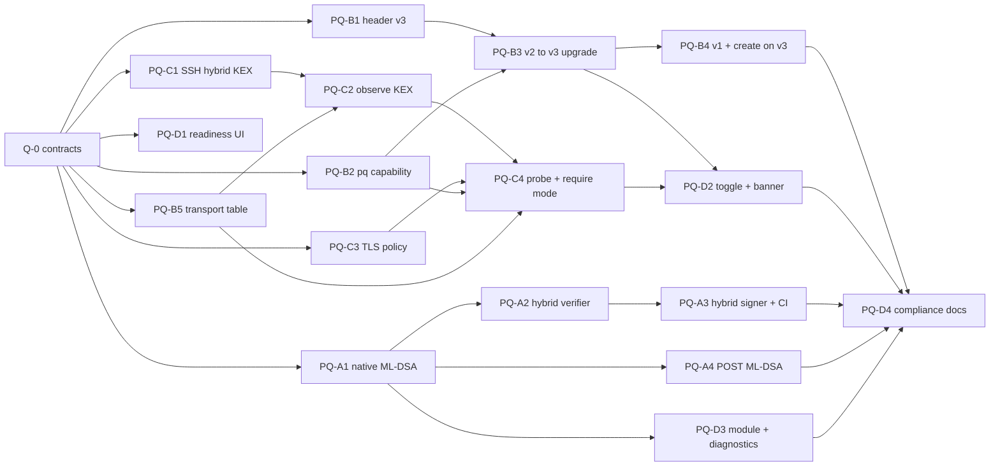

# Slate post-quantum migration roadmap

Document id `SLATE-PQ-2026-10-29` · status: accepted 2026-10-29 (phase 14, release 0.4.0); §4.8 decided as recommended: D-9 yes, D-6 stays deferred, D-10 prefer on and require off, D-11 ML-DSA-65, D-12 key generated by the lead · base: `main` at
`3a47a7b` (0.3.0). It amends nothing until the maintainer accepts it; where it touches the compliance programme,
[`compliance_audit.md`](compliance_audit.md) (`SLATE-CA-2026-10-23`) and
[`decisions.md`](../compliance/decisions.md) still take precedence.

**How to read this.** §1 says what is actually exposed to a quantum adversary, with measurements taken on
2026-10-29. §2 fixes the algorithms. §3 specifies the only format change (vault header v3) and the zero-loss
upgrade state machine. §4 is the work breakdown: each work package (WP) names the files it owns, what must merge
first, and the exact tests that close it, so up to six agents can run per wave without editing the same file.

---

## 1. Executive summary and threat model

### 1.1 Bottom line

1. **Notes at rest are already quantum-resistant, and no re-encryption is needed.** Every key that protects note
   data is symmetric: AES-256-GCM (`SLE1`/`SLE2`, vault wraps), SP 800-108r1 KBKDF and HMAC-SHA-256, SQLCipher 4
   (AES-256 + HMAC-SHA-512), Argon2id or PBKDF2-HMAC-SHA-512 password KEKs, and a 256-bit recovery key. Grover's
   algorithm leaves each of them at 128-bit or better post-quantum strength. The audit reached the same verdict
   (F-BSI-05). Re-encrypting vaults "into ML-KEM" would add attack surface and protect nothing.
2. **The live harvest-now-decrypt-later (HNDL) exposure is the sync transport**, and it matters most for users who
   sync **without** end-to-end encryption, whose Loro chunks cross the wire as plaintext inside SSH or TLS:
   - **Git over SSH.** Measured on the maintainer's Mac (OpenSSH 10.3p1, Apple build): the default negotiates
     classical `ecdh-sha2-nistp256` with github.com. Apple's build orders that method first, and no user config is
     involved. Both `mlkem768x25519-sha256` and `sntrup761x25519-sha512@openssh.com` work against GitHub when
     preferred. Slate controls the SSH command line (`PROMPT_FREE_ENV.GIT_SSH_COMMAND`), so this is **fixable in
     one place** (PQ-C1).
   - **OneDrive and Microsoft sign-in.** Electron 45's Node `tls` (BoringSSL) already *offers* `X25519MLKEM768` by
     default. `graph.microsoft.com` and `login.microsoftonline.com` answer with classical `secp384r1`, so the client
     side is done and the remaining gap is on the server (POA&M, PQ-D4).
   - **Git over HTTPS.** It uses the system git's libcurl (macOS: SecureTransport/LibreSSL 3.3.6, no hybrid
     groups), and GitHub's HTTPS endpoints negotiate classical `X25519`. Slate cannot change either, so it detects
     this, reports it, and recommends SSH.
3. **The second real exposure is update authenticity, not confidentiality.** Updates are signed with Ed25519 (C12). A
   cryptographically relevant quantum computer (CRQC) could forge a release signature, so the signer and verifier
   must become hybrid `ml-dsa-65+ed25519` well before one exists. CNSA 2.0 also asks that software signing be
   post-quantum exclusively by 2030. `signature.ts` already reserves the identifier.
4. **One invariant must hold for every future format: no public-key encryption without ML-KEM.** The audit
   reserved device and recipient wrap slots (D-6). If such a slot were ever classical, its ciphertext would sit in
   the sync remote forever and give a future CRQC the master key. Header v3 makes "hybrid only" a signed property
   of the vault and a schema rule (§3.2).
5. **No new dependency is needed.** The statically linked libcrypto (OpenSSL 3.5.9, `deps.lock.json`) already
   contains ML-KEM, ML-DSA and SLH-DSA in its default provider (verified: `_ossl_ml_kem_encap_seed`,
   `_ossl_ml_dsa_verify` and `_ossl_slh_dsa_verify` are in `.build/openssl/darwin-arm64/lib/libcrypto.a`). The
   validated FIPS Provider 3.1.2 (CMVP #4985) predates FIPS 203/204, so in the `fips-140-3` profile these
   algorithms run outside the module boundary or are refused (§2.3).

### 1.2 Measurements (2026-10-29, this repository, macOS arm64)

| Probe | Command | Result |
| --- | --- | --- |
| Electron runtime | `ELECTRON_RUN_AS_NODE=1 Electron -p process.versions` | Electron 45.0.0, Node 24.22.0, BoringSSL (`openssl: 0.0.0`), Chromium 156; `tls.DEFAULT_ECDH_CURVE = 'auto'` |
| PQ-capable server | `tls.connect` to `pq.cloudflareresearch.com` (default options) | TLS 1.3, group `X25519MLKEM768`: the default client offers the hybrid |
| Microsoft Graph | same, to `graph.microsoft.com` | `secp384r1`; forcing `X25519MLKEM768` (alone or with `X25519`) → `ECONNRESET` |
| Microsoft sign-in | same, to `login.microsoftonline.com` | `secp384r1`; same failure when forced |
| GitHub HTTPS | same, to `github.com`, `api.github.com` | `X25519`; `X25519MLKEM768` alone → handshake failure; `X25519MLKEM768:X25519` → `X25519` |
| P-256 hybrid | `ecdhCurve: 'SecP256r1MLKEM768'` | `ERR_CRYPTO_OPERATION_FAILED`: Electron 45's BoringSSL has no P-256 hybrid |
| Local OpenSSH | `ssh -V`; `ssh -Q kex` | OpenSSH_10.3p1; offers `mlkem768x25519-sha256`, `sntrup761x25519-sha512`, `sntrup761x25519-sha512@openssh.com` |
| Effective SSH order | `ssh -G github.com` | `ecdh-sha2-nistp256` first (no `KexAlgorithms` in `~/.ssh/config` or `/etc/ssh`) |
| SSH to GitHub, default | `ssh -v -T git@github.com` | `kex: algorithm: ecdh-sha2-nistp256` (classical) |
| SSH to GitHub, preferred | `-o 'KexAlgorithms=^mlkem768x25519-sha256,sntrup761x25519-sha512@openssh.com'` | `mlkem768x25519-sha256`, through `git ls-remote` as well |
| Unknown algorithm | `ssh -G -o 'KexAlgorithms=^bogus-kex' …` | exit 255, `Bad SSH2 KexAlgorithms`: candidates must be probed first |
| System git TLS | `/usr/bin/curl -V` | libcurl 8.7.1 (SecureTransport) LibreSSL/3.3.6: no hybrid groups |
| PQ in libcrypto | `nm libcrypto.a` | 344 ML-KEM symbols; ML-DSA and SLH-DSA verify present |

These are point-in-time facts about third-party servers. PQ-C4 turns them into a probe the app re-runs, so
the UI never relies on this table.

### 1.3 Attack vectors in the current layout

"HNDL" means traffic recorded today can be decrypted once a CRQC exists. "Forge-later" means a quantum adversary
can forge an authenticator once a CRQC exists, which needs migration before then but does not expose past data.

| Id | Vector (code) | Crypto today | Quantum attack | What it yields | Severity | Fix |
| --- | --- | --- | --- | --- | --- | --- |
| TQ-1 | Git sync over SSH: `packages/sync/src/gitRunner.ts` spawns the system `git`, which runs `ssh -o BatchMode=yes` | ECDH P-256 on macOS by default (measured); varies by distribution | HNDL (Shor on ECDH) | Plaintext users: all note content and history. E2EE users: sealed `SLE*` files, tree shape, sizes, timing | **High** (plaintext) / Low (E2EE) | PQ-C1, PQ-C2, PQ-C4, PQ-D1 |
| TQ-2 | Git sync over HTTPS: the same runner, token in `http.<host>.extraheader` (`tokenEnv`) | System libcurl: X25519 or P-256 (GitHub negotiates X25519) | HNDL | As TQ-1, plus the GitHub token (`gh auth token` or device-flow OAuth token) | **High** (plaintext) / Low (E2EE) | PQ-C2 (detect), PQ-C4 (require mode refuses), PQ-D1 (recommend SSH) |
| TQ-3 | OneDrive: `OneDriveClient` (`packages/sync/src/oneDrive.ts`), the importer's `graph.ts`, MSAL (`main/onenote/auth.ts`); all Node `fetch`/`https` on BoringSSL | Client offers `X25519MLKEM768`; Microsoft negotiates `secp384r1` (measured) | HNDL | Plaintext users' notes; OAuth refresh tokens (expire long before a CRQC) | **High** (plaintext) / Low (E2EE) | Client side done; PQ-C3 guards it against regressions; PQ-D4 records the server gap |
| TQ-4 | GitHub device flow and API (`main/sync/git/auth.ts`, Node `fetch`) | X25519 (server) | HNDL | An access token (revocable; low value later) | Low | PQ-C3 (regression guard) |
| TQ-5 | Update channel: `electron-updater` and `net.fetch` (`main/update/electronBackend.ts`); Ed25519 detached signatures (`main/update/signature.ts`, `scripts/sign-update.mjs`) | Ed25519 (EdDSA over Curve25519) | **Forge-later** (Shor on the discrete log) | A forged "newer" release, which runs as the user: code execution, keys of an unlocked vault | **High** (long-term) | PQ-A1, PQ-A2, PQ-A3, PQ-A4 |
| TQ-6 | Vault at rest: `vault.json` wraps, `local-keys.json`, `SLE1`/`SLE2`, SQLCipher, remote names | AES-256-GCM, KBKDF/HKDF over HMAC-SHA-256, AES-256-CTR/ECB names, SQLCipher 4 | Grover only (square-root speed-up) | Nothing practical: ≥ 2^128 work | Info | None. Header v3 locks the hybrid-only rule for the future (§3) |
| TQ-7 | Password and recovery guessing (`vault/kdf.ts`, `vault/recovery.ts`) | Argon2id (256 MiB) or PBKDF2 ≥ 600k; 256-bit recovery key | Grover on the password space | A quadratic speed-up on a memory-hard function per guess: negligible against the floors | Info | None |
| TQ-8 | Future public-key wrap slots (reserved: audit §4.5.4, D-6) | not built | HNDL, if they were ever classical | The master key, so every note | **High if built classically** | Header v3 `pq.kem = "hybrid-only"` plus a schema that accepts only hybrid algorithms (PQ-B1); hybrid KEM (Phase 3, PQ-A5) |
| TQ-9 | Transport authentication: SSH host keys (Ed25519/ECDSA), TLS certificates (ECDSA/RSA, WebPKI) | classical signatures | Forge-later, active MITM only once a CRQC exists | E2EE users: nothing readable (content sealed, `check` and GCM authenticate). Plaintext users: content | Residual | Outside Slate's control; E2EE is the mitigation (PQ-D1 nudge) |
| TQ-10 | Development chain: the guardrail unlock key (`tools/guards/unlock-key.pub`, Ed25519), the merge-wp signatures | Ed25519 | Forge-later | The repository's guard bypass | Low (local, short-lived trust) | Backlog item PQ-X1 (§4.7) |

Not affected: the MCP Unix socket (local, no network), the renderer (CSP allows no network), npm lockfile integrity
(SHA-512), and the SQLCipher format.

### 1.4 Where this roadmap departs from the brief

| Brief | Decision here | Why |
| --- | --- | --- |
| "Re-encrypt classical / format-2 vaults into a PQC-wrapped vault" | **No ciphertext is re-encrypted.** v2 vaults get a header-only upgrade to v3 (§3). v1 vaults use the existing C9 `upgrade` rekey, which writes v3 directly. | No asymmetric primitive protects vault data today (TQ-6). Touching ciphertext would add risk to the zero-loss requirement for no security gain. |
| Hybrid handshakes such as `mlkem768-ecdsa-p256` | SSH: `mlkem768x25519-sha256` (RFC 10042), with `sntrup761x25519-sha512@openssh.com` second. TLS: `X25519MLKEM768` (codepoint 0x11EC). | ECDSA is a signature scheme, not a key exchange. `SecP256r1MLKEM768` (0x11EB) does not exist in Electron 45's BoringSSL (measured). |
| `@open-quantum-safe/liboqs` node bindings | **Rejected.** ML-KEM, ML-DSA and SLH-DSA come from the OpenSSL 3.5.9 already linked into `@slate/native`. | `slate/crypto-through-native` and the dependency guard forbid a JavaScript or second native crypto library. liboqs says it is meant for prototyping and evaluation. The primitives are already in the binary (§1.2). |
| "Configure Node's `tls` module for hybrid" | **Keep `'auto'`, guard it, observe it** (PQ-C3, PQ-C4). | Electron 45's default already offers `X25519MLKEM768` first, and an explicit list would risk dropping `secp384r1`, which Microsoft needs. |
| "Seamless upgrade on first launch" | At the **first unlock** after the update, in the background, once every device can read v3. v1 vaults keep the prompt that D-7 requires. | Keys exist only after unlock. A v1→v2 rekey must show a new recovery key (audit §4.7 R-1), which needs the user. |

### 1.5 Non-goals

- Post-quantum TLS or SSH *authentication* (server certificates, host keys, user keys): Slate does not control them,
  and they are not an HNDL vector.
- Making Microsoft or GitHub offer hybrid TLS. Slate offers it, reports what it gets, and records the gap.
- A CNSA 2.0 suite for data at rest (HMAC-SHA-384 KBKDF, suite `0x03`). It is not needed for quantum resistance
  and stays in the backlog (PQ-X2).
- Any claim about the product's own validation status. Section 2.3 states exactly what runs inside the
  CMVP #4985 boundary.

---

## 2. Cryptographic target state

### 2.1 Algorithm choices

| Use | Today | Target | Standard | Why this fits Slate |
| --- | --- | --- | --- | --- |
| Note and vault encryption (`SLE2`, wraps, `local-keys.json`) | AES-256-GCM | **unchanged** | SP 800-38D; CNSA 2.0 (AES-256) | Already 256-bit. Grover leaves 128-bit security. Fresh key per file, so the GCM invocation bound holds |
| Key schedule | KBKDF HMAC-SHA-256 (suite 0x02); HKDF (suite 0x01, read only) | **unchanged** | SP 800-108r1 | 256-bit PRF keys; no quantum shortcut beyond Grover |
| Remote names | HMAC-SHA-256 SIV + AES-256-CTR (0x02); AES-ECB (0x01) | **unchanged** | audit §4.6 | Symmetric only |
| Local database | SQLCipher 4 (AES-256-CBC, HMAC-SHA-512) | **unchanged** | — | Symmetric only; the key is a 256-bit random LK |
| Password KEK | Argon2id (`standard`); PBKDF2-HMAC-SHA-512 (`fips-140-3`) | **unchanged** | RFC 9106; SP 800-132 | Quantum search does not beat memory-hard guessing at these floors |
| Git SSH key exchange | the system default (classical on macOS) | **`mlkem768x25519-sha256` preferred**, `sntrup761x25519-sha512@openssh.com` second, then the system's own list; *require* mode lists the hybrids only | RFC 10042; FIPS 203 (ML-KEM-768 component) | ML-KEM first because it is NIST-standardised. sntrup761 covers OpenSSH 9.0–9.8. Both are hybrids, so security is never below X25519 |
| HTTPS key exchange (Graph, MSAL, GitHub API) | `auto`, which offers `X25519MLKEM768` first | **unchanged default, pinned by a regression test** | draft-ietf-tls-ecdhe-mlkem; FIPS 203 | Hybrid wherever the server supports it, classical fallback (`secp384r1`) where it does not |
| Update signatures | Ed25519 | **`ml-dsa-65+ed25519`**: both must verify, each over a domain-separated message | FIPS 204; CNSA 2.0 software signing | Hybrid, so a flaw in either scheme alone does not break updates. ML-DSA-65 (category 3) is what `key-inventory.json` already plans. ML-DSA-87 only on request (D-11) |
| Update-key rotation root (optional, PQ-X3) | none | SLH-DSA-SHA2-256s offline key signs key-transition statements | FIPS 205 | Hash-based, so it survives a lattice break; rarely used, so its slow signing does not matter |
| Device / recipient wrap slots (Phase 3, D-6) | reserved | `mlkem768-x25519-kdf56c` (`standard`); `mlkem1024-p384-kdf56c` (`fips-140-3`, only with a provider whose certificate covers FIPS 203) | FIPS 203; SP 800-227; SP 800-56C r2; IG D.S | One combiner for both profiles, approvable by construction. The approved shared secret comes first. Ciphertexts and public keys are bound into the KDF context (§3.8) |

Rejected: Kyber round-3 identifiers (`X25519Kyber768Draft00`, codepoint 0x6399) are pre-standard. Classical-only KEM
slots are forbidden by schema. Stateful LMS/XMSS for release signing is rejected because CI signs without a
state store, and a lost state means key reuse.

### 2.2 Library-context architecture after this roadmap

```
@slate/native (slate_native.node)
├── g_fips_ctx  ── OpenSSL FIPS Provider 3.1.2 (CMVP #4985) + base   ◄ the validated boundary (unchanged)
│     AES-256-GCM · KBKDF · HMAC · PBKDF2 · DRBG · SHA-2      (no ML-KEM / ML-DSA: the certificate predates FIPS 203/204)
│     later: a FIPS provider whose certificate lists FIPS 203/204 (PQ-A6, blocked on CMVP)
└── g_std_ctx   ── OpenSSL 3.5.9 default provider (outside the boundary)
      Argon2id · HKDF (suite 0x01) · AES-ECB (suite 0x01 names)       ← existing, refused after requireApprovedKeys
      NEW: ML-DSA-65/87 verify (public data only)                       ← allowed in both profiles (PQ-A1)
      NEW (Phase 3): ML-KEM-768/1024 + X25519/P-384 hybrid wrap         ← standard only; refused (SCC_16) when approved-only
```

The transports (system `ssh`, system `git`/libcurl, BoringSSL in Electron) stay outside `@slate/native`, as
POAM-11 already records. PQ-C* change *configuration and observation* of those stacks, never their code.

### 2.3 Profile matrix

| | `standard` | `fips-140-3` |
| --- | --- | --- |
| Header written | v3 (once every device can read it) | v3 (once every device can read it) |
| ML-DSA update verification | `g_std_ctx` | `g_std_ctx`, outside the boundary: not a note-protecting operation, and the same placement as today's Ed25519 in `node:crypto` |
| Device slots (Phase 3) | `mlkem768-x25519-kdf56c` | refused (`FipsPqUnavailable`) until PQ-A6; then `mlkem1024-p384-kdf56c` only |
| SSH and TLS hybrid preference | on (PQ-C1, PQ-C3) | on |
| "Require post-quantum key exchange" | user choice, default off | user choice, default off (D-10) |
| POST additions | `POST-MLDSA-VERIFY` | `POST-MLDSA-VERIFY` (reported as outside the module) |

### 2.4 Invariants (each one is enforced by a named test in §4)

| Id | Invariant | Enforced by |
| --- | --- | --- |
| INV-PQ-1 | No persistent artefact (header, envelope, device record, local file) carries public-key encryption without an ML-KEM component | v3 schema `alg` enum; T-PQ-B1-04; PQ-A5 tests |
| INV-PQ-2 | No ciphertext of note data changes during the format upgrade | T-PQ-B3-02 (byte-compare) |
| INV-PQ-3 | The password, the recovery key and quick unlock keep working across the upgrade, without being re-entered | T-PQ-B3-01 |
| INV-PQ-4 | Once a device adopted v3, it refuses every v2 copy of that vault's header | T-PQ-B3-05 (`profile-floor.json` `minHeaderVersion = 3`) |
| INV-PQ-5 | No header v3 is written while any device record other than this device's own (`devices/<deviceId>.json`) lacks `pq ≥ 1` or cannot be read | T-PQ-B2-02, T-PQ-B3-04; `deviceGate.test.ts` and `pqUpgrade.test.ts` (own record) |
| INV-PQ-6 | `GIT_SSH_COMMAND` contains only literal, allowlisted algorithm names, never probe output | T-PQ-C1-03 |
| INV-PQ-7 | Main sets TLS groups only in `tlsPolicy.ts`, and the default client offers `X25519MLKEM768` | T-PQ-C3-01, T-PQ-C3-03 |
| INV-PQ-8 | A build that pins a hybrid update key never accepts an Ed25519-only signature | T-PQ-A2-03 |
| INV-PQ-9 | A `fips-140-3` vault's upgrade calls no legacy primitive, and no PQ primitive is presented as inside the module | T-PQ-B3-07, T-PQ-D3-01 |

---

## 3. Data schema and migration protocol

### 3.1 What changes and what does not

| Artefact | Change | Old builds reading the new form |
| --- | --- | --- |
| `vault.json` (local and `e2ee/vault.json`) | **v2 → v3**: `version: 3`, a new required `pq` object, wraps may also hold `device-<uuid>` slots (empty until Phase 3). Password and recovery wraps, `kdf`, `profile`, `suite` and `keyEpoch` are byte-identical. `check` and `revision` are recomputed | 0.3.x refuses an unknown version as `BadHeader` and writes nothing. INV-PQ-5 keeps v3 off the remote while such a device is active |
| `profile-floor.json` | `minHeaderVersion` raised to 3 (format unchanged) | — |
| Device record (sealed `e2ee/v/<dev>.c`; plaintext `devices/<id>.json`) | new capability `pq: 1` (reads v3 and carries device slots). Phase 3: `pq: 2` and `kemPub` | Unknown fields are ignored (the engine spreads capabilities) |
| `migration.json` | new record kind `pq-header` (§3.5) | Never read by older builds: it is local only |
| SQLite (`DocStore`) | new table `transport_observations` (PQ-B5). Phase 3: `device_keys` | Additive `CREATE TABLE IF NOT EXISTS`. Older builds ignore the tables, so downgrading the app is safe |
| `SLE1`/`SLE2` envelopes, `local-keys.json`, `quick-unlock.bin`, `preunlock.json`, SQLCipher pages, blob rows | **none** | — |

There is no `PRAGMA user_version` in `DocStore`. The schema is additive by convention (the golden path "A database
table or column"), and this roadmap keeps that convention.

### 3.2 Vault header v3: JSON Schema

New file `docs/compliance/schemas/vault-header-v3.schema.json` (PQ-B1). It is the v2 schema with the marked
differences. `parseHeaderV3` accepts exactly the documents this schema accepts that also satisfy rules 1–10 in
§3.3.

```json
{
  "$schema": "https://json-schema.org/draft/2020-12/schema",
  "$id": "urn:slate:schema:vault-header:3",
  "title": "Slate vault header v3 (vault.json)",
  "type": "object",
  "additionalProperties": false,
  "required": ["format", "version", "vaultId", "revision", "createdAt", "profile", "suite", "keyEpoch", "kdf", "wraps", "pq", "check"],
  "properties": {
    "format": { "const": "slate-vault" },
    "version": { "const": 3 },
    "vaultId": { "$ref": "#/$defs/uuid" },
    "revision": { "type": "integer", "minimum": 1, "maximum": 9007199254740991 },
    "createdAt": { "type": "integer", "minimum": 0, "maximum": 9007199254740991 },
    "profile": { "enum": ["standard", "fips-140-3"] },
    "suite": { "const": 2 },
    "keyEpoch": { "type": "integer", "minimum": 0, "maximum": 4294967295 },
    "kdf": { "$comment": "identical to vault-header-v2.schema.json#/properties/kdf" },
    "wraps": {
      "type": "object",
      "required": ["password"],
      "maxProperties": 18,
      "properties": { "password": { "$ref": "#/$defs/wrap" }, "recovery": { "$ref": "#/$defs/wrap" } },
      "patternProperties": {
        "^device-[0-9a-f]{8}-[0-9a-f]{4}-4[0-9a-f]{3}-[89ab][0-9a-f]{3}-[0-9a-f]{12}$": { "$ref": "#/$defs/deviceWrap" }
      },
      "additionalProperties": false
    },
    "history": { "type": "array", "maxItems": 4, "items": { "$ref": "#/$defs/history" } },
    "pq": {
      "type": "object",
      "additionalProperties": false,
      "required": ["kem", "minCapability"],
      "properties": {
        "kem": { "const": "hybrid-only" },
        "minCapability": { "type": "integer", "minimum": 1, "maximum": 255 }
      }
    },
    "check": { "type": "string", "pattern": "^[A-Za-z0-9+/]{42}[AEIMQUYcgkosw048]=$" }
  },
  "$defs": {
    "uuid": { "type": "string", "pattern": "^[0-9a-f]{8}-[0-9a-f]{4}-4[0-9a-f]{3}-[89ab][0-9a-f]{3}-[0-9a-f]{12}$" },
    "b64": { "type": "string", "pattern": "^(?:[A-Za-z0-9+/]{4})*(?:[A-Za-z0-9+/]{2}==|[A-Za-z0-9+/]{3}=)?$" },
    "salt": { "$comment": "identical to v2" },
    "wrap": { "$comment": "identical to v2: {alg: aes-256-gcm, nonce 16 chars, ct 64 chars}" },
    "history": { "$comment": "identical to v2" },
    "deviceWrap": {
      "type": "object",
      "additionalProperties": false,
      "required": ["alg", "pkHash", "kemCt", "ecdhPub", "nonce", "ct", "addedAt", "addedBy"],
      "properties": {
        "alg": { "enum": ["mlkem768-x25519-kdf56c", "mlkem1024-p384-kdf56c"] },
        "pkHash": { "type": "string", "pattern": "^[A-Za-z0-9+/]{42}[AEIMQUYcgkosw048]=$" },
        "kemCt": { "allOf": [{ "$ref": "#/$defs/b64" }, { "minLength": 1452, "maxLength": 2092 }] },
        "ecdhPub": { "allOf": [{ "$ref": "#/$defs/b64" }, { "minLength": 44, "maxLength": 132 }] },
        "nonce": { "type": "string", "pattern": "^[A-Za-z0-9+/]{16}$" },
        "ct": { "type": "string", "pattern": "^[A-Za-z0-9+/]{64}$" },
        "addedAt": { "type": "integer", "minimum": 0, "maximum": 9007199254740991 },
        "addedBy": { "$ref": "#/$defs/uuid" }
      }
    }
  }
}
```

The committed file must inline the four `"$comment": "identical to v2"` definitions verbatim from
`vault-header-v2.schema.json`. The guard `tools/guards/headerSchema.test.ts` compares the parser against the
schema, so an abbreviated schema would fail it. Size check: 16 device slots at most (about 2.3 KiB each for
ML-KEM-1024) keep the header under the 64 KiB `readJsonCapped` cap.

### 3.3 Semantic rules for v3 (all `BadHeader` before any derivation)

1. to 4. As v2 (salt canonical, 16–64 bytes; profile ↔ KDF; history epochs distinct and `< keyEpoch`; 64 KiB cap).
5. `pq.kem` is `"hybrid-only"` (a schema constant, restated so a future schema cannot relax it silently).
6. `pq.minCapability` ≥ 1, and ≥ 2 if any `device-*` slot is present.
7. Each device slot decodes to exact lengths for its `alg`: `mlkem768-x25519-kdf56c` → `kemCt` 1088 B and `ecdhPub`
   32 B; `mlkem1024-p384-kdf56c` → `kemCt` 1568 B and `ecdhPub` 97 B (uncompressed, leading `0x04`). `pkHash` 32 B.
8. `profile: "fips-140-3"` allows only `mlkem1024-p384-kdf56c` slots.
9. **Wrap AAD continuity.** The password and recovery wraps of a v3 header use the v2 AAD byte for byte:
   `"slate-vault/v2|" + vaultId + "|" + slot + "|" + profile + "|" + suite + "|" + keyEpoch + "|" + JCS(kdf)`.
   The label is the *wrap format*, not the header version. This is what lets the upgrade run without the recovery
   key (§3.4).
10. **Carry-through.** A build that parses device slots but cannot open them (capability `pq: 1`) copies them
    unchanged into every header it rewrites (password change, new recovery key, rotation). JCS makes the copy
    byte-stable, and `check` covers it.

`check` stays `HMAC-SHA-256(K_check, JCS(header without "check"))`, so it authenticates `version` and `pq`.
Rolling back to the v2 header (a valid MAC, a lower revision) is refused twice: by the revision rule, and by the
profile floor `minHeaderVersion = 3` (INV-PQ-4).

### 3.4 Why the upgrade is zero-loss by construction

- **No secret is needed beyond the unlocked session.** The upgrade needs `K_check`, which comes from MK in the open
  `KeyRing`, to MAC the new header. Wraps are copied, not rewrapped (rule 9), so neither the password nor the
  recovery key is asked for, and both keep working.
- **No ciphertext is touched.** `SLE*` files, names, `local-keys.json`, `quick-unlock.bin`, SQLCipher pages and blob
  rows stay byte-identical, because `keyEpoch`, `suite`, `vaultId` and every subkey derivation are unchanged.
  T-PQ-B3-02 proves this by byte comparison.
- **Every write is a compare-and-swap (CAS), as audit §15 N2 requires.** The new header is built on the highest
  verified header, with `revision = max + 1`. If two devices upgrade at once, the CAS loser adopts the winner.
- **Every step is resumable** through `migration.json`, with the same crash-injection discipline as C9
  (`crashAt`, and `SLATE_E2E=1` hooks only).
- **Lock and quit are safe.** The upgrade holds the vault-change lock (`vault/busy.ts`). The lock sequence waits for
  the current step or aborts it at a step boundary, never in the middle of a write.

### 3.5 State machine: first unlock on a PQ-capable build

```mermaid
stateDiagram-v2
    [*] --> SelfTest
    SelfTest --> SelftestFailed: any KAT fails (terminal, unchanged C6)
    SelfTest --> Plaintext: no vault.json
    SelfTest --> Locked: vault.json present
    Plaintext --> Plaintext: sync works; PQ-C1 transport preference applies; PQ-D1 suggests encryption
    Plaintext --> Created: "Encrypt my notes…" (createVault writes v3 if the gate allows, else v2)
    Locked --> Unlocked: password / recovery / quick unlock (unchanged)
    Unlocked --> Resume: migration.json has kind pq-header
    Unlocked --> Classify: no pq-header record
    Resume --> Committed: step committed
    Resume --> Classify: step staged (discard the candidate, start over)
    Classify --> Done: header v3
    Classify --> OfferV1: header v1 (suite 0x01)
    Classify --> Gate: header v2
    OfferV1 --> C9Upgrade: user accepts the banner (new recovery key shown and re-entered; D-7)
    C9Upgrade --> Done: rekey "upgrade" writes v3 directly when the gate allows (PQ-B4)
    Gate --> Waiting: a device record lacks pq >= 1, or cannot be read
    Waiting --> Gate: after the next completed sync
    Gate --> PrePost: all records pq >= 1, or sync off
    PrePost --> Staged: pre-change self-test passed
    PrePost --> SelftestFailed: pre-change self-test failed
    Staged --> Committed: candidate v3 built and MAC'd; migration.json step committed
    Committed --> RemoteCas: sync on
    Committed --> LocalSwap: sync off
    RemoteCas --> LocalSwap: CAS accepted
    RemoteCas --> Adopt: CAS lost, and the remote is v3 for this vaultId and verifies under MK
    RemoteCas --> Staged: CAS lost, the remote moved (rebuild on the highest, at most 3 tries)
    RemoteCas --> Committed: offline (retry after the next sync)
    Adopt --> LocalSwap
    LocalSwap --> Floor: vault.json v3 written with writeJsonAtomic
    Floor --> Done: profile-floor minHeaderVersion 3; migration.json removed; event vault.header.upgraded
```

Step table (the new file `packages/desktop/src/main/vault/pqUpgrade.ts`, PQ-B3):

| Step | Action | Durable effect | Crash here → next unlock |
| --- | --- | --- | --- |
| `classify` | `parseHeader` on the local and pending headers. Take the highest verified one | none | restart |
| `gate` | `devicesLacking(records, 'pq', 1)` (PQ-B2) over the remote's device records. Skipped when sync is off | none | restart |
| `prepost` | the pre-change self-test (audit §4.2, `phase: 'pre-change'`) | none | restart |
| `staged` | build the v3 header: copy every field, `version: 3`, `pq: {kem: "hybrid-only", minCapability: 1}`, `revision + 1`, `check` under `K_check`. Write `vault.candidate.json` and `migration.json {kind: "pq-header", id, step: "staged", vaultId, fromRevision, toRevision}` | candidate only; `vault.json` untouched | discard the candidate and record, start again |
| `committed` | `migration.json.step = "committed"` | record | retry the remote CAS with the same candidate |
| `remote` | the CAS write of `e2ee/vault.json` (git: a commit pushed alone, rebase conflict → take theirs and rebuild; OneDrive: `If-Match: <eTag>`, 412 → re-download and rebuild) | remote v3 | committed: retry; if the remote already holds this candidate, go on |
| `local` | `writeJsonAtomic(vault.json, candidate)` | local v3 | the local v2 is still valid. Pending-header adoption (spec §4) picks up the remote v3 at the next unlock; the record finishes `floor` |
| `floor` | `profile-floor.json.minHeaderVersion = 3` (MAC'd with `K_prefs`); remove the candidate and `migration.json`; log `vault.header.upgraded {fromRevision, toRevision}` | done | cleanup only |

**Other devices.** A `pq`-capable device sees the higher remote revision, stores it as pending (spec §4) and
adopts it at its next unlock, because the user's password opens the byte-identical wrap. It then raises its own
floor. Nothing on that device is re-encrypted either.

**Devices on 0.3.x or older.** The gate keeps v3 off the remote while their records are present. A device that
was never recorded (or a re-installed old build) reads a v3 header and refuses it as damaged. It writes nothing
and keeps its local notes, and it resumes syncing once updated. T-PQ-B3-08 pins the current build's equivalent
behaviour for an unknown `version: 4`.

**Plaintext users.** There is no vault, so there is nothing to migrate. Their quantum exposure is TQ-1 to TQ-3,
reduced by PQ-C1 and closed only by "Encrypt my notes…", which PQ-D1 offers whenever sync is on. Vaults created
after PQ-B4 start as v3 if the gate allows.

### 3.6 v1 vaults (suite 0x01)

They follow the existing C9 path: `Migration.prepareRekey(keyRing, 'upgrade', password)`, then `runRekey`, then
`afterSync` (`repush`, `sweep`, `prune`). That path already re-pushes under suite 0x02 with a history epoch, so
old files stay readable until swept, and it is crash-tested with `expectNotesSurviveCrash`. PQ-B4 changes only the
header it emits: v3 instead of v2 when the gate allows, so a v1 vault reaches v3 in a single CAS. The prompt
stays, as D-7 requires.

### 3.7 SQLite additions

```sql
-- PQ-B5: the last observed key exchange per remote (no secrets; the remote's host only)
CREATE TABLE IF NOT EXISTS transport_observations (
  remote TEXT PRIMARY KEY,          -- 'git-ssh:github.com' | 'git-https:github.com' | 'onedrive:graph.microsoft.com' | ...
  transport TEXT NOT NULL,          -- 'ssh' | 'tls'
  kex TEXT,                         -- 'mlkem768x25519-sha256' | 'X25519MLKEM768' | 'secp384r1' | null (unknown)
  pq INTEGER NOT NULL,              -- 1 hybrid, 0 classical, -1 unknown
  source TEXT NOT NULL,             -- 'probe' | 'test-connection'
  at INTEGER NOT NULL
);
-- Phase 3 (PQ-B6), only if D-6 is reopened
CREATE TABLE IF NOT EXISTS device_keys (
  device_id TEXT PRIMARY KEY, alg TEXT NOT NULL, public_key BLOB NOT NULL, pk_hash BLOB NOT NULL,
  added_at INTEGER NOT NULL, revoked_at INTEGER
);
```

Both tables live in the (encrypted, when a vault exists) database, are opened only through `openDatabase`, and use
literal SQL with `?` parameters (`slate/sql-text-is-literal`).

### 3.8 Phase 3: hybrid device slots (specified now, built only if D-6 is reopened)

```
pk_dev  = ek_mlkem ‖ pk_ecdh                      (ML-KEM-768 + X25519, or ML-KEM-1024 + P-384)
(ct_kem, ss_kem) = ML-KEM.Encaps(ek_mlkem)          FIPS 203
(e, E)  = ephemeral ECDH key pair;  ss_ecdh = ECDH(e, pk_ecdh)
Z       = ss_kem ‖ ss_ecdh                           approved secret first (SP 800-227, IG D.S)
PRK     = HMAC-SHA-256(key = "slate-hybrid-kem/v3", Z)                       SP 800-56C r2, extraction step
ctx     = vid ‖ uuid16(deviceId) ‖ SHA-256(ct_kem ‖ E ‖ pk_dev)              binds ciphertext and recipient
KEK_dev = KBKDF(PRK, "slate/v3/device-wrap", ctx)                             SP 800-108r1 (existing scc_kbkdf)
slot    = { alg, pkHash = SHA-256(pk_dev), kemCt = ct_kem, ecdhPub = E, nonce, ct = AES-256-GCM(KEK_dev, MK_keyEpoch,
            AAD = "slate-vault/v3|device|" + vaultId + "|" + deviceId + "|" + keyEpoch + "|" + JCS(slot minus nonce, ct)) }
```

- The private keys (`dk_mlkem`, `sk_ecdh`) are generated in the secure heap under a new usage class
  `SCC_USE_DEVICE_KEK` (opens MASTER keys only, as the password class does). They are stored the way quick
  unlock's QU is (`secretStorage.ts`, a real OS keyring). That also means the slot is a convenience at the
  quick-unlock level, which the README must say.
- `kemPub` (pk_dev) travels in the device's `SLE2`-sealed record, so a key rotation (C9 R-1) can re-encapsulate
  to every enrolled device.
- Decapsulation failure, a ciphertext swapped between slots, or a slot moved to another vault all fail as
  `SCC_11`, through the same error path as a wrong password.

---

## 4. Decoupled implementation blueprint

### 4.0 Operating rules for the agents

- **Phase name:** `phase14`. **Branches:** `phase14/<wp-id-lowercase>-<slug>` (for example
  `phase14/pq-c1-ssh-kex`). **Ledger:** `.agent-reports/phase14/ledger.md`, kept by the lead.
  **Runner:** `scripts/agents/run-agent.sh` with `scripts/agents/common-brief.md`, plus this section and the WP
  text as the brief.
- **At most six agents per wave.** Two waves with thirteen agents crashed the Mac. Check `df` between waves
  (e2e temp roots).
- **Every WP follows [`CLAUDE.md`](../../CLAUDE.md)**: the definition of done, a red test first, Conventional
  Commits, no AI attribution, no `--no-verify`, no push. Every WP here is on a security path
  (`tools/guards/security-paths.txt`) except PQ-D1/D2 renderer files, so merge-wp needs the security review
  (`docs/review/REVIEW.md`). Renderer WPs also need a UI scenario whose screenshots someone looked at
  (`npm run ui:review`).
- **Test ids.** Every new test title starts with its id (`T-PQ-<WP>-<nn>: …`) so `scripts/traceability.mjs` can
  trace it. A test that cannot run until a later WP merges is an `it.todo('T-PQ-…: … (PQ-xx)')`, registered
  unconditionally (`slate/tests-registered-unconditionally`).
- **Guard files are lead-only.** Where a WP lists *Lead-only*, the agent writes the change as a patch under
  `.agent-reports/phase14/<wp>/guard.patch` and stops that item. The lead applies it with a signed unlock and a
  `Guardrail-Change:` trailer. Agents never edit `tools/**`, `.github/**`, `.claude/**` or `scripts/agents/**`.
- **No new dependency in any WP.** If a WP seems to need one, stop and report it under "Guardrail conflicts".
- **Native rebuilds.** After `npm run -w @slate/native build`, copy the CI-built FIPS provider into
  `packages/native/fips/darwin-arm64/`, or the POST fails (`SelfTestFailed`). A worktree that copies the native
  build copies the provider too.

### 4.1 File ownership matrix

A file has one writer per wave. "Q-0" means the contracts WP owns the file for the whole phase: later WPs import
from it but never edit it. If they need a change there, they report it and the lead makes it.

| File | Owner (wave) | Notes |
| --- | --- | --- |
| `packages/desktop/src/shared/api.ts`, `shared/ipc.ts`, `preload/index.ts`, `main/ipcGuard.ts` (`CHANNEL_POLICY` rows) | Q-0 (0) | contracts and stubs |
| `packages/desktop/src/shared/settings/schema.ts` | Q-0 (0) | parallel settings keys broke the typecheck at merge before |
| `packages/native/src/slate_crypto_core.{c,h}`, `src/binding.c`, `index.ts`, `test/kat.c`, `test/surface.test.ts`, `scripts/build-openssl.mjs` | PQ-A1 (1); PQ-A5 (P3) | |
| `packages/desktop/src/main/vault/native.ts` | PQ-A1 (1) | adds `verifyMlDsa` |
| `packages/desktop/src/main/update/**` | PQ-A2 (2) | |
| `scripts/sign-update.mjs` | PQ-A3 (3) | `scripts/**` is a security path; `scripts/agents/**` is lead-only |
| `packages/desktop/src/main/vault/selftest/{vectors,post,report}.ts` | PQ-A4 (2) | |
| `packages/desktop/src/main/vault/header.ts`, `header.test.ts`, `fuzz.test.ts` | PQ-B1 (1); PQ-B4 (4) | |
| `docs/compliance/schemas/vault-header-v3.schema.json` | PQ-B1 (1) | |
| `packages/desktop/src/main/vault/deviceGate.ts` | PQ-B2 (2) | new |
| `packages/desktop/src/main/sync/syncService.ts` | PQ-B2 (2); PQ-C4 (3) | hotspot |
| `packages/desktop/src/main/vault/pqUpgrade*.ts`, `profileFloor.ts`, `fipsProfile.test.ts` | PQ-B3 (3) | |
| `packages/desktop/src/main/vault/migration.ts` | PQ-B3 (3, the record-kind union only); PQ-B4 (4) | hotspot |
| `packages/desktop/src/main/index.ts` | PQ-C3 (1); PQ-B3 (3) | hotspot: one call line each |
| `packages/desktop/src/main/store.ts`, `store.test.ts` | PQ-B5 (1) | |
| `packages/sync/src/gitRunner.ts`, `packages/sync/test/sshKex*.test.ts` | PQ-C1 (1) | `gitRunner.ts` is already in `process-imports.json`, so the probe's spawn goes there (no allowlist growth) |
| `packages/sync/src/transport.ts`, `main/sync/git/auth.ts` | PQ-C2 (2) | |
| `packages/desktop/src/main/tlsPolicy.ts` | PQ-C3 (1) | new |
| `packages/desktop/src/main/static.test.ts` | PQ-C3 (1) | |
| `packages/desktop/src/main/sync/transportProbe.ts` | PQ-C4 (3) | new |
| `renderer/src/settings/sections/QuantumReadinessGroup.tsx`, `quantumReadinessText.ts`, `SecuritySection.tsx` | PQ-D1 (1) | |
| `renderer/src/sync/SyncSettings.tsx`, `renderer/src/lock/MigrationBanner.tsx` | PQ-D2 (4) | |
| `renderer/src/settings/sections/{CryptoModuleGroup.tsx,cryptoModuleText.ts,DiagnosticsSection.tsx}` | PQ-D3 (2) | |
| `docs/compliance/**` (except the v3 schema), `README.md`, `CHANGELOG.md` | PQ-D4 (4) | |

### 4.2 Wave 0: contracts

#### Q-0: Shared contracts, IPC stubs, settings keys

| | |
| --- | --- |
| Branch | `phase14/q-0-contracts` |
| Prerequisites | none |
| Target files | `packages/desktop/src/shared/api.ts`, `shared/ipc.ts`, `main/ipcGuard.ts`, `preload/index.ts`, `shared/settings/schema.ts`, a new `main/pqIpc.ts` with its test `pqIpc.test.ts`, one `registerPqIpc` call in `main/index.ts` |
| Lead-only | none |

Scope: everything the parallel WPs share, landed first so nothing else edits these files.

```ts
// shared/api.ts
export type PqLevel = 'hybrid' | 'classical' | 'unknown'
export interface TransportObservation { remote: string; transport: 'ssh' | 'tls'; kex: string | null; pq: PqLevel; source: 'probe' | 'test-connection'; at: number }
export interface PqReadiness {
  atRest: 'symmetric-256'                          // constant: §2.1
  vault: { kind: 'none' } | { kind: 'header'; version: 1 | 2 | 3; upgrade: 'none' | 'waiting-devices' | 'running' | 'offer-v1' | 'done'; blockingDevices: string[] }
  transports: TransportObservation[]
  updateSignature: 'ed25519' | 'ml-dsa-65+ed25519'
  plaintextSync: boolean                           // sync on and no vault
  requirePq: boolean
}
// VaultApi: pqReadiness(): Promise<PqReadiness>        SyncApi: checkTransport(): Promise<TransportObservation[]>
```

- Channels through `npm run new:channel -- vaultPqReadiness --policy unlocked` and
  `npm run new:channel -- syncCheckTransport --policy unlocked`. Neither is served while locked, so
  `allowlists/ipc-ungated.json` does not grow.
- Settings: `syncRequirePq: { default: false, sanitize: boolean }` (copy `idleMinutes`). It is not written to
  `preunlock.json`, because the lock screen does not need it.
- Stub handlers in `main/pqIpc.ts` return `{ atRest: 'symmetric-256', vault: { kind: 'none' }, transports: [], updateSignature: 'ed25519', plaintextSync: false, requirePq: false }` until PQ-B3, PQ-C4 and PQ-A2 replace each field's source.

Verification:
- `T-PQ-Q0-01`: `pqIpc.test.ts`: the `vaultPqReadiness` handler, through a fake registrar, returns a `PqReadiness`
  and refuses a non-empty argument list.
- `T-PQ-Q0-02`: `pqIpc.test.ts`: `syncCheckTransport` refuses any argument.
- `T-PQ-Q0-03`: `shared/settings/schema.test.ts`: `syncRequirePq` sanitises non-booleans to the default.
- `npm run guards` passes (`ipcChannels.test.ts`: exactly one `ipc.handle` per new channel; `ipcGuard.test.ts`:
  both channels throw `Locked` in `locked` and `selftest` states).

### 4.3 Track A: dependencies and local crypto modules

#### PQ-A1: ML-DSA verification (and a PQ inventory) in `@slate/native`

| | |
| --- | --- |
| Branch | `phase14/pq-a1-native-mldsa` · wave 1 · Opus · security review |
| Prerequisites | Q-0 |
| Target files | `packages/native/src/slate_crypto_core.c`, `slate_crypto_core.h`, `src/binding.c`, `index.ts`, `test/kat.c`, `test/pq.test.ts` (new), `test/vectors/mldsa/` (new: ACVP subsets), `test/surface.test.ts`, `test/crossCheck.sh`, `scripts/build-openssl.mjs`; `packages/desktop/src/main/vault/native.ts` |
| Lead-only | none |

Scope:
- `int scc_mldsa_verify(int level /* 65 | 87 */, const unsigned char *spki_der, size_t spki_len, const unsigned char *msg, size_t msg_len, const unsigned char *ctx, size_t ctx_len, const unsigned char *sig, size_t sig_len)`.
  It runs `EVP_PKEY_verify_message_init` / `EVP_PKEY_verify_message` (ML-DSA "pure" mode, FIPS 204 §5.2, with a
  context string) in `g_std_ctx`. It returns `SCC_OK` or `SCC_ERR_AUTH`; any malformed input is `SCC_ERR_ARG`; and
  it checks lengths against `SCC_MAX_INPUT` before narrowing. The SPKI must decode to exactly
  `ML-DSA-65`/`ML-DSA-87` (OID check), otherwise `SCC_ERR_ARG`. No key handle is involved: this operates on
  public data only.
- It is **not** refused by `scc_require_approved_keys`, a decision this WP documents in the header comment.
- `NativeStatus` gains `pqAlgorithms: string[]` (those `EVP_PKEY_CTX_new_from_name(g_std_ctx, …)` can create among
  `ML-KEM-768`, `ML-KEM-1024`, `ML-DSA-65`, `ML-DSA-87`, `SLH-DSA-SHA2-256s`) and `pqInFipsBoundary: boolean`
  (true only if the FIPS provider in `g_fips_ctx` offers `ML-KEM-768` and `ML-DSA-65`; false with 3.1.2).
- TS: `mldsaVerify(level: 65 | 87, spkiDer: Uint8Array, msg: Uint8Array, ctx: Uint8Array, sig: Uint8Array): boolean`.
  `vault/native.ts` re-exports `verifyMlDsa(...)`, so `main/update` never imports `@slate/native` directly.
- `build-openssl.mjs`: after the build, fail it if `nm libcrypto.a` lacks `ossl_ml_dsa_verify` or
  `ossl_ml_kem_encap_seed`, or if the `Configure` arguments ever contain `no-ml-dsa`, `no-ml-kem` or `no-slh-dsa`.

Verification (`packages/native/test/pq.test.ts` unless stated):
- `T-PQ-A1-01`: accepts the ACVP `ML-DSA-sigVer-FIPS204` ML-DSA-65 external/pure vector (`testPassed: true`), and
  rejects the same tcId with one flipped signature bit (`false`, no throw).
- `T-PQ-A1-02`: rejects a valid signature over a message with a different context string.
- `T-PQ-A1-03`: an Ed25519 SPKI, an empty signature, or a signature longer than 4627 bytes → throws `SCC_1`.
- `T-PQ-A1-04`: works after `requireApprovedKeys()`, and `status().approvedKeysOnly` stays true (run in its own
  child, as in `latchChild.mjs`).
- `T-PQ-A1-05`: `status().pqAlgorithms` contains `ML-DSA-65` and `ML-KEM-768`; `status().pqInFipsBoundary === false`
  with provider 3.1.2.
- `T-PQ-A1-06` (`test/kat.c`, `npm run -w @slate/native kat`): the C-level pass and fail cases.
- `T-PQ-A1-07` (`test/surface.test.ts`): the export list gains exactly `mldsaVerify`, and `nm -D` still lists only
  the two N-API symbols (`scripts/check-exports.mjs`).
- `T-PQ-A1-08` (`test/crossCheck.sh`): `openssl pkeyutl -verify -rawin` from the OpenSSL 3.5.9 build agrees on both
  vectors.

#### PQ-A2: Hybrid update-signature verifier `ml-dsa-65+ed25519`

| | |
| --- | --- |
| Branch | `phase14/pq-a2-hybrid-update-sig` · wave 2 · Opus · security review |
| Prerequisites | PQ-A1 merged |
| Target files | `packages/desktop/src/main/update/signature.ts`, `signature.test.ts`, `verifier.ts`, `verifier.test.ts`, `fakeBackend.ts`, `electronBackend.ts` (fetches the `.pq.sig` names), `updateService.test.ts`; `packages/desktop/e2e/update.spec.ts` |
| Lead-only | none (the existing `crypto-imports.json` entries cover Ed25519; ML-DSA goes through `vault/native.ts`) |

Format (`slate-update-signature` version 2, file suffix `.pq.sig` next to the existing `.sig`):

```json
{ "format": "slate-update-signature", "version": 2, "alg": "ml-dsa-65+ed25519", "keyId": "<16 hex>",
  "sig": { "ed25519": "<b64 64 B>", "mldsa65": "<b64 3309 B>" } }
```

- Each component signs `M' = "slate-update/v2|ml-dsa-65+ed25519|" ‖ keyId ‖ "|" ‖ M`, where `M` is the message v1
  signs today (the feed bytes, or the artefact's SHA-512). ML-DSA also takes the context string
  `"slate-update"`. Binding the algorithm pair and key id into both messages stops a component being stripped or
  moved to another key.
- `PinnedUpdateKey` becomes a union: `{alg: 'ed25519', publicKeyPem}` | `{alg: 'ml-dsa-65+ed25519', ed25519Pem, mldsa65SpkiB64}`.
  `keyId` for the hybrid key = the first 16 hex digits of SHA-256(DER(ed25519 SPKI) ‖ DER(ML-DSA SPKI)).
- **Downgrade rule (INV-PQ-8).** If any pinned key is hybrid, the verifier fetches and requires `.pq.sig` and never
  falls back to `.sig`. Builds without a hybrid key behave as today.
- The real hybrid public key is pinned only after the maintainer's key ceremony (§4.8 D-12). Until then the tests
  use a generated key from `fakeBackend.ts`, and production builds pin Ed25519 only, so behaviour is unchanged.

Verification:
- `T-PQ-A2-01` (`signature.test.ts`): a feed signed by the pinned hybrid test key verifies.
- `T-PQ-A2-02`: a valid Ed25519 half with a corrupted ML-DSA half is refused, and a valid ML-DSA half with a
  corrupted Ed25519 half is refused.
- `T-PQ-A2-03`: with a hybrid key pinned, a correct v1 `.sig` alone is refused (`UpdateSignatureError`, "post-quantum
  signature missing").
- `T-PQ-A2-04`: a component signature computed over `M` instead of `M'` is refused (domain separation).
- `T-PQ-A2-05`: a `.pq.sig` over 16 KiB, or with unknown keys, is refused before any verify call (count calls with
  `spyOnNative`).
- `T-PQ-A2-06` (`e2e/update.spec.ts`): the fake feed with a hybrid signature offers the update; with the ML-DSA half
  stripped, it is not offered and the log has `update.signature.failed`.

#### PQ-A3: Hybrid signer and release workflow

| | |
| --- | --- |
| Branch | `phase14/pq-a3-hybrid-signer` · wave 3 · Sonnet · security review |
| Prerequisites | PQ-A2 merged |
| Target files | `scripts/sign-update.mjs`; `packages/desktop/src/main/update/signRelease.test.ts` |
| Lead-only | `.github/workflows/release.yml`: add the secret `SLATE_UPDATE_SIGNING_KEY_MLDSA` to the signing step's env, and assert `node -p "process.versions.openssl"` ≥ 3.5 before signing |

Scope:
- `sign-update.mjs` writes `<file>.sig` (v1, unchanged, for clients up to 0.3.x) **and** `<file>.pq.sig` (v2) for
  every artefact and feed.
- ML-DSA-65 signing uses `crypto.sign(null, M', { key, context })` on CI's Node 24, which is built against OpenSSL
  3.5. The script first checks that `crypto.getHashes`/`KeyObject` support `ml-dsa-65`, and otherwise fails with a
  clear message. It never falls back to unsigned.
- It refuses a key pair whose public half is not in `PINNED_UPDATE_KEYS` (as today).

Verification:
- `T-PQ-A3-01` (`signRelease.test.ts`): signing a temp `dist/` with generated keys writes both files, and
  `signature.ts` (PQ-A2) verifies `.pq.sig` with the matching pinned key.
- `T-PQ-A3-02`: an ML-DSA key not pinned in the app → exit code ≠ 0 and no `.pq.sig` written.
- `T-PQ-A3-03`: the v1 `.sig` output is byte-identical to the 0.3.0 signer's for the same input and key
  (fixture), so old clients keep updating.

#### PQ-A4: POST known-answer test for ML-DSA

| | |
| --- | --- |
| Branch | `phase14/pq-a4-post-mldsa` · wave 2 · Sonnet · security review |
| Prerequisites | PQ-A1 merged |
| Target files | `packages/desktop/src/main/vault/selftest/vectors.ts`, `post.ts`, `report.ts`, `post.test.ts`, `post.mutation.test.ts`, `vectors.test.ts` |
| Lead-only | `tools/guards/selfTest.test.ts` (if it pins the KAT id list) |

Scope: add `POST-MLDSA-VERIFY` to `KAT_IDS`, with one pass vector and one fail vector (the fail vector must be
rejected). The report marks it `boundary: 'outside'`. It stays within the whole-run budget (S-5); measure and
record the delta in the WP report.

Verification:
- `T-PQ-A4-01` (`post.test.ts`): a full POST runs `POST-MLDSA-VERIFY` and passes.
- `T-PQ-A4-02` (`post.mutation.test.ts`): a native mock that accepts the flipped signature → `selftest-failed` with
  `failed: ['POST-MLDSA-VERIFY']`.
- `T-PQ-A4-03`: POST total time with the new KAT stays under the existing budget assertion.
- `e2e/selftest.spec.ts` still passes.

#### PQ-A5 (Phase 3, only if D-6 is reopened): hybrid KEM device wrap in the module

| | |
| --- | --- |
| Branch | `phase14/pq-a5-hybrid-kem` · Opus · security review |
| Prerequisites | PQ-A1, PQ-B1 merged; maintainer decision D-6 |
| Target files | as PQ-A1, plus `test/kem.test.ts` |

Scope: `scc_hybrid_kem_keygen(alg, uint32_t *priv, unsigned char *pub, size_t *pub_len)` (secure heap, usage
`SCC_USE_DEVICE_KEK`); `scc_hybrid_kem_wrap_master(pub, alg, uint32_t mk, ctx…, out slot bytes)`, which seals
only a MASTER key that a proof opens, as `scc_history_seal` does; `scc_hybrid_kem_unwrap_master(priv, slot, ctx…,
uint32_t *mk)`. Combiner exactly as §3.8. ML-KEM via `EVP_PKEY_encapsulate`; deterministic test mode only in
`SCC_KAT_BUILD` (`OSSL_PKEY_PARAM_ML_KEM_SEED`, `ikme`).

Verification: `T-PQ-A5-01` round trip for both algorithms; `-02` a wrong private key → `SCC_11`; `-03` a `kemCt`
or `ecdhPub` swapped from another slot → `SCC_11`; `-04` after `requireApprovedKeys` with provider 3.1.2 → `SCC_16`;
`-05` KAT against a fixed seed (vectors generated by the OpenSSL 3.5.9 CLI and committed); `-06` no handle or byte
of MK leaves the call (`spyOnNative` counts no `gcmOpenKey`).

#### PQ-A6 (blocked on CMVP): a FIPS provider that covers FIPS 203/204

Starts when CMVP lists an OpenSSL FIPS provider certificate whose algorithm list includes ML-KEM and ML-DSA. Scope:
`deps.lock.json` `fipsProvider`, `fips-digest.json` pins, `docs/compliance/crypto-module.json`, the L-3/L-4
questions restated for the new version, and `pqInFipsBoundary` turning true. Verification: `fipsProfile.test.ts`
matrix green on the new provider; `scripts/smoke-native.cjs` reaches approved mode in the packaged app; T-PQ-A1-05
flips to `true`. The maintainer decides; no agent starts it.

### 4.4 Track B: storage layer and migration schemas

#### PQ-B1: Header v3 schema, parser and serializer

| | |
| --- | --- |
| Branch | `phase14/pq-b1-header-v3` · wave 1 · Opus · security review |
| Prerequisites | Q-0 |
| Target files | `docs/compliance/schemas/vault-header-v3.schema.json` (new); `packages/desktop/src/main/vault/header.ts`, `header.test.ts`, `fuzz.test.ts`; `vault/fixtures/pq/` (new: v3 headers, valid and tampered) |
| Lead-only | `tools/guards/headerSchema.test.ts`: add the v3 schema-equivalence case next to v2 |

Scope: `parseHeaderV3` (schema, then rules 1–10 of §3.3), a `VaultHeader` union with `version: 3`,
`buildHeaderV3From(v2, mk)` (pure: copies the wraps, sets `pq`, `revision + 1`, MACs under `K_check` from the ring).
`parseHeader` dispatches on `version` before any derivation. No writer calls `buildHeaderV3From` yet; PQ-B3 does.

Verification (`header.test.ts`, `fuzz.test.ts`):
- `T-PQ-B1-01`: every `fixtures/pq/valid-*.json` parses, and each `fixtures/pq/invalid-*.json` (one per schema
  clause and per rule 5–8) is `BadHeader`.
- `T-PQ-B1-02`: `buildHeaderV3From(v2)` keeps `wraps.password` and `wraps.recovery` byte-identical, and the result
  unlocks with the v2 password and recovery key.
- `T-PQ-B1-03`: a v3 header with any tampered field (`pq.minCapability`, `version`, a device slot byte) fails
  `check` with the same error and timing path as a wrong password (reuse the existing indistinguishability helper).
- `T-PQ-B1-04`: a slot whose `alg` is a classical-only identifier (`x25519-kdf56c`, `rsa-oaep-sha256`) → `BadHeader`
  (INV-PQ-1).
- `T-PQ-B1-05`: 17 device slots, or a header over 64 KiB → `BadHeader`, with zero native calls (`spyOnNative`).
- `T-PQ-B1-06`: `version: 4` → `BadHeader` before any derivation.
- `T-PQ-B1-07`: carry-through: a password change on a v3 header that holds one schema-valid device slot keeps it
  byte-identical (rule 10).
- `T-PQ-B1-08` (`fuzz.test.ts`): 10,000 mutated v3 headers never throw anything but `BadHeader`/`WrongSecret`.

#### PQ-B2: The `pq` device capability and the upgrade gate

| | |
| --- | --- |
| Branch | `phase14/pq-b2-capability-gate` · wave 2 · Sonnet · security review |
| Prerequisites | Q-0 |
| Target files | `packages/desktop/src/main/vault/deviceGate.ts` (new), `deviceGate.test.ts` (new); `packages/desktop/src/main/sync/syncService.ts` (`capabilities: { epochs: KEY_EPOCHS_CAPABILITY, pq: PQ_CAPABILITY }`, and the `pq` field when parsing records), `syncService.test.ts` |
| Lead-only | none |

Scope: `export const PQ_CAPABILITY = 1`. `devicesLacking(records, cap: 'epochs' | 'pq', level)` returns every
record without the capability at that level, plus every record that cannot be read. The existing
`devicesBlocking` in `migration.ts` is left alone; PQ-B4 moves it onto `deviceGate.ts`.

Verification:
- `T-PQ-B2-01` (`syncService.test.ts`): after one sync over `memoryDrive`, this device's record carries `pq: 1` and
  still `epochs: 1`.
- `T-PQ-B2-02` (`deviceGate.test.ts`): a record without `pq`, with `pq: 0`, or unreadable → listed; `pq: 1` and
  `pq: 2` → not listed.
- `T-PQ-B2-03`: the device-record churn rule holds: a second sync with no change writes no new record (spec §5.5).

#### PQ-B3: The v2 → v3 header upgrade state machine

| | |
| --- | --- |
| Branch | `phase14/pq-b3-upgrade` · wave 3 · Opus · security review |
| Prerequisites | PQ-B1, PQ-B2 merged |
| Target files | `packages/desktop/src/main/vault/pqUpgrade.ts` (new), `pqUpgrade.test.ts`, `pqUpgradeCrash.test.ts`, `profileFloor.ts`, `fipsProfile.test.ts`, `migration.ts` (the record-kind union and `readRekeyRecord` ignoring `pq-header` only), `main/pqIpc.ts` (`vault.upgrade` field), one call in `main/index.ts` after `openServices`; `packages/desktop/e2e/pq-upgrade.spec.ts` (new), `e2e/fixtures/` (a v2 data folder plus a bare remote made by 0.3.0) |
| Lead-only | none |

Scope: exactly §3.5's machine. It runs after unlock, never blocks the UI, holds `vault/busy.ts`, reuses
`remoteVault.ts`'s CAS write and the pending-header adoption, and keeps the crash hooks `crashAt` and
`SLATE_E2E=1`. Events: `vault.header.upgraded {fromRevision, toRevision}`, and `vault.header.upgrade-waiting
{devices: count}` (count only, no names).

Verification:
- `T-PQ-B3-01` (`pqUpgrade.test.ts`): after the upgrade, the old password, the recovery key and quick unlock each
  unlock, and the note count is unchanged (INV-PQ-3).
- `T-PQ-B3-02`: **zero-loss byte compare.** Every file in the data folder except `vault.json`,
  `profile-floor.json` and `migration.json`, every `blob_data` row, every SQLCipher page (raw file bytes), and every
  remote path except `e2ee/vault.json` are byte-identical before and after (INV-PQ-2).
- `T-PQ-B3-03` (`pqUpgradeCrash.test.ts`): a crash injected before each of `staged`, `committed`, `remote`, `local`
  and `floor`, followed by a fresh unlock, ends on v3 (or v2 with a pending v3 that is then adopted) and finishes
  with `expectNotesSurviveCrash` (`vault/testVault.ts`).
- `T-PQ-B3-04`: one remote device record without `pq` → nothing written, state `waiting-devices`, the blocking
  count reported (INV-PQ-5).
- `T-PQ-B3-05`: after the upgrade, presenting the old v2 header (valid MAC) locally or as the remote copy →
  `HeaderRefused` (`downgrade`) (INV-PQ-4).
- `T-PQ-B3-06`: two devices over one `memoryDrive` (and over a local bare git repo) upgrading together end on one
  v3 header at `revision = base + 1`; the CAS loser adopts and writes nothing of its own.
- `T-PQ-B3-07` (`fipsProfile.test.ts`): the upgrade of a `fips-140-3` vault makes zero calls to `LEGACY` and does
  not call `mldsaVerify` (INV-PQ-9).
- `T-PQ-B3-08`: the current parser given a `version: 4` remote header records `vault.header.refused (schema)`,
  stops syncing and writes nothing.
- `T-PQ-B3-09`: the upgrade starts only after a passing pre-change self-test; a failing one ends in
  `selftest-failed` with nothing written.
- `T-PQ-B3-10` (`e2e/pq-upgrade.spec.ts`): launch on the 0.3.0 v2 fixture, unlock, wait for the readiness state
  `done`, relaunch, unlock with the password, then with the recovery key, and check that a known note's text is
  intact both times.

#### PQ-B4: v1 vaults and new vaults land on v3

| | |
| --- | --- |
| Branch | `phase14/pq-b4-v1-and-create` · wave 4 · Opus · security review |
| Prerequisites | PQ-B3 merged |
| Target files | `packages/desktop/src/main/vault/header.ts` (`createVault`, `RekeyInput` for `upgrade`), `migration.ts` (`prepareRekey`, `devicesBlocking` → `deviceGate.ts`), `rekey.test.ts`, `rotation.test.ts`, `crossVersion.test.ts`, `vault/fixtures/` (a v1 fixture from the C4 era already exists under `fixtures/c4`) |
| Lead-only | none |

Verification:
- `T-PQ-B4-01` (`rekey.test.ts`): a header-v1 vault run through `upgrade` with the gate open lands on v3 in one
  remote CAS, and the crash test ends with `expectNotesSurviveCrash`.
- `T-PQ-B4-02`: with the gate closed, the same upgrade lands on v2 (as today), and PQ-B3 later raises it to v3.
- `T-PQ-B4-03`: `createVault` with sync off writes v3 with `pq: {kem: "hybrid-only", minCapability: 1}`; with a
  remote whose device records lack `pq`, it writes v2.
- `T-PQ-B4-04` (`crossVersion.test.ts`): the v1, v2 (0.3.0) and v3 fixtures all unlock, and their notes match.
- `T-PQ-B4-05`: rotation (`rotate`) and conversion (`convert`) of a v3 vault keep `version: 3` and carry device
  slots through (rule 10).

#### PQ-B5: `transport_observations` table

| | |
| --- | --- |
| Branch | `phase14/pq-b5-transport-table` · wave 1 · Sonnet · architecture review |
| Prerequisites | Q-0 |
| Target files | `packages/desktop/src/main/store.ts`, `store.test.ts` |

Scope: the §3.7 table in the `CREATE TABLE IF NOT EXISTS` block; `recordTransport(o: TransportObservation)`
(upsert on `remote`); `transportObservations(): TransportObservation[]`.

Verification:
- `T-PQ-B5-01`: opening a 0.3.0 database fixture (plaintext, and encrypted through `openDatabase`) creates the table
  and changes no existing row (row counts and `integrity_check`).
- `T-PQ-B5-02`: an observation round-trips, and a second one for the same remote replaces it.
- `T-PQ-B5-03`: `remote` values are host-level only: a URL with a user, path or token is refused (`Error`), so no
  credential is ever stored.

#### PQ-B6 (Phase 3, only if D-6 is reopened): `device_keys` and enrolment

Builds §3.8 on PQ-A5: the `device_keys` table, `pq: 2` with `kemPub` in the sealed device record, "Approve this
device" on an unlocked device (wraps MK into a `device-<uuid>` slot through a v3 header CAS), revocation (drop the
slot, `revision + 1`, and recommend a rotation). Verification ids `T-PQ-B6-*`. Specify them when D-6 is decided.

### 4.5 Track C: transport and sync layer hardening

#### PQ-C1: Prefer hybrid SSH key exchange for git

| | |
| --- | --- |
| Branch | `phase14/pq-c1-ssh-kex` · wave 1 · Opus · security review |
| Prerequisites | Q-0 |
| Target files | `packages/sync/src/gitRunner.ts`, `packages/sync/src/index.ts` (exports), `packages/sync/test/sshKex.test.ts` (new), `packages/sync/test/sshKex.integration.test.ts` (new) |
| Lead-only | none (`gitRunner.ts` is already in `process-imports.json`; the probe's spawn lives there) |

Scope:

```ts
export const PQ_KEX = ['mlkem768x25519-sha256', 'sntrup761x25519-sha512@openssh.com', 'sntrup761x25519-sha512'] as const
export type KexPolicy = 'prefer' | 'require'
/** Once per process: `ssh -Q kex` ∩ PQ_KEX, in PQ_KEX order, then validated with `ssh -G -o KexAlgorithms=… slate-probe.invalid` (no network). */
export function probeSshKex(spawnFn?: typeof spawn): Promise<{ hybrid: readonly (typeof PQ_KEX)[number][]; ssh: string | null }>
/** 'prefer' → `ssh -o BatchMode=yes -o KexAlgorithms=^a,b`; 'require' → `ssh -o BatchMode=yes -o KexAlgorithms=a,b`;
 *  no hybrid available → 'prefer' returns today's `ssh -o BatchMode=yes`, 'require' throws PqTransportUnavailable. */
export function sshCommand(probe: Awaited<ReturnType<typeof probeSshKex>>, policy: KexPolicy): string
```

- `nodeGitRunner` takes `sshCommand` as an option. Callers that pass none get today's
  `PROMPT_FREE_ENV.GIT_SSH_COMMAND`, so the change is opt-in until PQ-C4 wires it.
- When both sntrup names are available, keep only the `@openssh.com` one: they are aliases.
- `GIT_SSH_COMMAND` is run by git through `/bin/sh`. Only the literal strings in `PQ_KEX` may enter it, selected by
  equality against probe lines, never by copying probe text (INV-PQ-6).
- `^` (prepend to the default list) is validated through `ssh -G`. If an older OpenSSH rejects it, fall back to an
  explicit list: the hybrids, then `curve25519-sha256,ecdh-sha2-nistp256,ecdh-sha2-nistp384,diffie-hellman-group16-sha512`.

Verification:
- `T-PQ-C1-01` (`sshKex.test.ts`, fake spawn): `ssh -Q kex` output from OpenSSH 10.3 →
  `ssh -o BatchMode=yes -o KexAlgorithms=^mlkem768x25519-sha256,sntrup761x25519-sha512@openssh.com`.
- `T-PQ-C1-02`: OpenSSH 8.9 output (sntrup only) → `^sntrup761x25519-sha512@openssh.com`; OpenSSH 8.4 output (no
  hybrid) → today's command and `hybrid: []`.
- `T-PQ-C1-03`: probe output with `mlkem768x25519-sha256;touch /tmp/x` or `$(id)` lines → those lines are ignored,
  and the command matches `/^ssh -o BatchMode=yes( -o KexAlgorithms=\^?[a-z0-9@.,-]+)?$/` (INV-PQ-6).
- `T-PQ-C1-04`: `require` with no hybrid → `PqTransportUnavailable`; with hybrids → a list without `^`.
- `T-PQ-C1-05`: `ssh -G` rejecting `^` → the explicit-list fallback, which itself passes `ssh -G`.
- `T-PQ-C1-06` (`sshKex.integration.test.ts`, real `ssh` on the CI runner): the command built for this machine
  makes `ssh -G slate-probe.invalid` exit 0, and its `kexalgorithms` line starts with the chosen hybrid. Runs on
  macOS and Ubuntu CI; no network.

#### PQ-C2: Observe the negotiated key exchange

| | |
| --- | --- |
| Branch | `phase14/pq-c2-observe-kex` · wave 2 · Sonnet · security review |
| Prerequisites | PQ-C1, PQ-B5 merged |
| Target files | `packages/sync/src/transport.ts` (new: pure parsers), `packages/sync/test/transport.test.ts` (new) with fixtures `packages/sync/test/fixtures/kex/*.txt`; `packages/desktop/src/main/sync/git/auth.ts` (`testConnection` returns `kex` and `pq`), `auth.test.ts` |

Scope:
- `parseSshKex(stderr): string | null` reads `debug1: kex: algorithm: <name>`.
- `parseCurlTls(trace): string | null` reads the group from curl's `SSL connection using TLSv1.3 / <cipher> / <group> / …`
  line. SecureTransport traces carry no group, so the result is `null`, which maps to `pq: 'unknown'`.
- `classifyKex(name): PqLevel`, with a fixed table: the hybrids in `PQ_KEX` plus `X25519MLKEM768`,
  `SecP256r1MLKEM768` and `SecP384r1MLKEM1024` are `hybrid`; everything else is `classical`; null is `unknown`.
- `testConnection` runs `git ls-remote` once with `GIT_SSH_COMMAND=<PQ-C1 command> -v` (SSH) or `GIT_TRACE_CURL=1`
  (HTTPS). The token stays only in the `GIT_CONFIG_*` env, and traces are parsed in memory, never logged.

Verification:
- `T-PQ-C2-01`: the OpenSSH 8.9, 9.6 and 10.3 verbose fixtures give `sntrup761x25519-sha512@openssh.com`,
  `sntrup761x25519-sha512@openssh.com` and `mlkem768x25519-sha256`, each classified `hybrid`;
  `ecdh-sha2-nistp256` → `classical`.
- `T-PQ-C2-02`: a curl 8 OpenSSL-3.5 trace with `X25519MLKEM768` → `hybrid`; a SecureTransport trace → `unknown`.
- `T-PQ-C2-03` (`auth.test.ts`, fake runner): a successful verbose `ls-remote` is not classified as signed-out or
  offline by `gitError` (the debug lines must not match `SIGNED_OUT` or `OFFLINE`).
- `T-PQ-C2-04`: a `GIT_TRACE_CURL` trace containing `Authorization: basic …` never reaches the logger (logger spy)
  or the returned object.

#### PQ-C3: TLS key-exchange policy and its regression guard

| | |
| --- | --- |
| Branch | `phase14/pq-c3-tls-policy` · wave 1 · Opus · security review |
| Prerequisites | Q-0 |
| Target files | `packages/desktop/src/main/tlsPolicy.ts` (new), `tlsPolicy.test.ts` (new), `packages/desktop/src/main/fixtures/tls/` (a test-only self-signed P-256 certificate and key, marked as such), `main/index.ts` (one `applyTlsPolicy()` call before any network), `main/static.test.ts` |
| Lead-only | `tools/guards/security-paths.txt`: add `packages/desktop/src/main/tlsPolicy.ts` |

Scope:
- `applyTlsPolicy()` asserts `tls.DEFAULT_ECDH_CURVE === 'auto'` and leaves it. On another value it logs
  `transport.tls.policy-changed` and resets it to `'auto'`. It also exports `HYBRID_TLS_GROUP = 'X25519MLKEM768'`
  for the probe (PQ-C4).
- No explicit group list is set: the measurements (§1.2) show that `'auto'` offers the hybrid first and keeps
  `secp384r1`, which Microsoft selects.
- A static check stops anyone else from setting `ecdhCurve` or `DEFAULT_ECDH_CURVE` in main-process code.

Verification (`npm run test:main`, which runs on Electron's Node and BoringSSL):
- `T-PQ-C3-01` (`tlsPolicy.test.ts`): a loopback `tls.createServer({ ecdhCurve: 'X25519MLKEM768', … })` with the
  fixture certificate, and a client using default options plus that CA → handshake succeeds, and
  `getEphemeralKeyInfo().name === 'X25519MLKEM768'`.
- `T-PQ-C3-02`: a loopback server restricted to `secp384r1` → the default client still connects (classical
  fallback kept).
- `T-PQ-C3-03` (`static.test.ts`): no file under `MAIN_PROCESS` roots except `tlsPolicy.ts` contains `ecdhCurve`
  or `DEFAULT_ECDH_CURVE` (INV-PQ-7).
- `T-PQ-C3-04`: `applyTlsPolicy()` after something set `DEFAULT_ECDH_CURVE = 'X25519'` restores `'auto'` and logs
  the event once.

#### PQ-C4: Transport probe and "require post-quantum key exchange"

| | |
| --- | --- |
| Branch | `phase14/pq-c4-probe-require` · wave 3 · Opus · security review |
| Prerequisites | PQ-C1, PQ-C2, PQ-C3, PQ-B2 (for `syncService.ts`), PQ-B5 merged |
| Target files | `packages/desktop/src/main/sync/transportProbe.ts` (new), `transportProbe.test.ts`; `packages/desktop/src/main/sync/syncService.ts`, `syncService.test.ts`; `main/pqIpc.ts` (`syncCheckTransport`, `transports` field) |

Scope:
- `probeTransports(settings)`:
  - git SSH: `testConnection` (PQ-C2);
  - git HTTPS: `testConnection` with `GIT_TRACE_CURL`;
  - OneDrive: a bare `tls.connect` to `graph.microsoft.com:443` and `login.microsoftonline.com:443` with default
    options, reading `getEphemeralKeyInfo()`. No HTTP request is sent and no token is used.
  - Results go to `recordTransport` with `source: 'probe'`.
- It runs on `syncCheckTransport`, after the sync remote changes, and at most once every 24 hours after a
  successful sync. Never while locked, and never from the renderer directly.
- `syncRequirePq`:
  - git SSH: `sshCommand(probe, 'require')`. A server without hybrids fails with
    `PqTransportUnavailable` ("This server does not offer post-quantum key exchange"), recorded as a sync notice.
  - git HTTPS: refused before any network call ("Use an SSH remote for post-quantum key exchange").
  - OneDrive: refused with "Microsoft OneDrive does not offer post-quantum key exchange yet". The setting UI
    (PQ-D2) explains this before the user turns it on.
- Without `syncRequirePq`, git SSH always uses `sshCommand(probe, 'prefer')` (D-10).

Verification:
- `T-PQ-C4-01` (`syncService.test.ts`, fake runner): `prefer` → every network git call carries the
  `KexAlgorithms=^…` command.
- `T-PQ-C4-02`: `require` with ssh stderr `no matching key exchange method found` → a `PqTransportUnavailable` sync
  error, and **nothing pushed** (the `memoryDrive` and git bare repo are unchanged).
- `T-PQ-C4-03`: `require` with an HTTPS remote, or with OneDrive → refused before any `fetch` or `git` call (call
  counters stay 0).
- `T-PQ-C4-04` (`transportProbe.test.ts`): the probe against loopback servers (as in T-PQ-C3-01/02) records
  `hybrid` and `classical` respectively, and sends zero application bytes after the handshake.
- `T-PQ-C4-05`: the probe refuses to run while the vault state is not `unlocked` (or `plaintext`).
- `e2e/git-sync.spec.ts` and `e2e/sync.spec.ts` still pass (they use local `file://` remotes, which have no SSH;
  the policy must not affect them).

### 4.6 Track D: UI and diagnostic updates

#### PQ-D1: Settings → Security, "Post-quantum readiness"

| | |
| --- | --- |
| Branch | `phase14/pq-d1-readiness-ui` · wave 1 · Sonnet · UI review |
| Prerequisites | Q-0 |
| Target files | `packages/desktop/src/renderer/src/settings/sections/QuantumReadinessGroup.tsx` (new), `quantumReadinessText.ts` (new), `quantumReadinessText.test.ts` (new), `SecuritySection.tsx` (one include), `settings.css`; `packages/desktop/e2e/ui/security.ui.spec.ts` (scenario states) |

Rows (all wording in `quantumReadinessText.ts`):

| Row | States |
| --- | --- |
| Notes on this computer and in sync | "AES-256: resistant to known quantum attacks" (constant) |
| Vault format | v3 "Current" · v2 waiting "Will update when every device runs Slate 0.4 or newer: <n> devices" · v2 running "Updating…" · v1 "Upgrade encryption format…" (existing C9 action) · none |
| Sync connection | per remote: "Post-quantum key exchange (ML-KEM)" · "Classical key exchange: the server does not offer post-quantum" · "Classical: this computer's ssh/git cannot" · "Not checked" + **Check now** (`window.slate.sync.checkTransport()`) |
| Update signatures | "Ed25519" / "ML-DSA-65 + Ed25519 (post-quantum)" |
| Notice (plaintext sync only) | "Your notes sync unencrypted. Their protection in transit depends on the connection above, which may be recorded and decrypted later by a quantum computer. **Encrypt my notes…**" |

Rules: never say "quantum-proof", "unbreakable" or "validated"; do not put a key exchange name in prose without
its plain-language state; use the existing themed controls (the UI audit).

Verification:
- `T-PQ-D1-01` (`quantumReadinessText.test.ts`): each `PqReadiness` fixture (v3+hybrid, v2-waiting+classical,
  v1, plaintext+sync) maps to the rows above.
- `T-PQ-D1-02`: no produced string matches `/quantum-proof|unbreakable|validated|certified/i`.
- `T-PQ-D1-03` (`security.ui.spec.ts`): four scenario states pass the UI audit (no clipped or overlapping text,
  contrast), with screenshots in `ui-review/`.

#### PQ-D2: Sync setting and upgrade banner

| | |
| --- | --- |
| Branch | `phase14/pq-d2-sync-toggle-banner` · wave 4 · Sonnet · UI review |
| Prerequisites | PQ-B3, PQ-C4 merged |
| Target files | `packages/desktop/src/renderer/src/sync/SyncSettings.tsx`, `sync.css`; `renderer/src/lock/MigrationBanner.tsx`; `e2e/settings.spec.ts`, `e2e/ui/settings.ui.spec.ts` |

Scope:
- **"Require post-quantum key exchange"** checkbox (`syncRequirePq`). For OneDrive and HTTPS git it is disabled,
  with the reason text from PQ-C4. With SSH, turning it on runs `checkTransport()` first and warns if the last
  observation is classical.
- `MigrationBanner` shows a non-blocking line while `vault.upgrade === 'running'`, and "Vault format updated" once
  after `done`. The v1 offer reuses the existing C9 banner.

Verification:
- `T-PQ-D2-01` (`settings.spec.ts`): with a git SSH remote, the toggle persists across relaunch; with OneDrive it is
  disabled and explains why.
- `T-PQ-D2-02`: the banner never covers the editor or takes focus (focus stays in the page; existing focus
  helpers).
- `T-PQ-D2-03` (`settings.ui.spec.ts`): the toggle's enabled and disabled states and the banner's states pass the
  UI audit.

#### PQ-D3: Crypto module group and diagnostics

| | |
| --- | --- |
| Branch | `phase14/pq-d3-module-diagnostics` · wave 2 · Sonnet · UI review |
| Prerequisites | PQ-A1 merged |
| Target files | `renderer/src/settings/sections/CryptoModuleGroup.tsx`, `cryptoModuleText.ts`, `cryptoModuleText.test.ts`, `DiagnosticsSection.tsx`; `packages/desktop/src/main/native/cryptoModule.ts` (the `CryptoModuleStatus` fields from `NativeStatus.pqAlgorithms` and `pqInFipsBoundary`), `cryptoModule.test.ts`; `e2e/diagnostics.spec.ts` |

Scope:
- A new row "Post-quantum algorithms": "ML-KEM, ML-DSA available (OpenSSL 3.5.9, outside the validated module)".
  In `fips-140-3`: "Not in the validated module: CMVP #4985 predates FIPS 203 and FIPS 204".
- The diagnostics export gains `transports` (host-level observations from PQ-B5) and `vaultHeaderVersion`, both
  through the redacting logger.

Verification:
- `T-PQ-D3-01` (`cryptoModuleText.test.ts`): for `pqInFipsBoundary: false` the row never implies the algorithms are
  inside the module, in either profile (INV-PQ-9).
- `T-PQ-D3-02` (`diagnostics.spec.ts`): the exported bundle contains `transports` with hosts only (no URL path,
  user or token: a regex check) and passes `redact()`.

#### PQ-D4: Compliance documents, inventory and release notes

| | |
| --- | --- |
| Branch | `phase14/pq-d4-compliance-docs` · wave 4 · Sonnet · security review |
| Prerequisites | every wave-1 to wave-3 WP merged |
| Target files | `docs/compliance/key-inventory.json` (`UPD_SIG_MLDSA` public key entry; `UPD_SIG` algorithm text), `crypto-module.json` (`pqAlgorithms`, `pqInBoundary: false`), `poam.md`, `decisions.md` (record D-9 to D-12 as answered), `security-policy.md` (a "Post-quantum" section), `oscal/slate-component-definition.json` (remarks), `traceability.yaml` (regenerated by `node scripts/traceability.mjs`), `README.md` (security section), `CHANGELOG.md` (Unreleased) |
| Lead-only | none |

New POA&M rows:
- **POAM-17** (SC-8, SC-8(1), HNDL): Microsoft Graph and sign-in, and GitHub HTTPS, negotiate classical key
  exchange (measured 2026-10-29). In place meanwhile: the client offers `X25519MLKEM768` (T-PQ-C3-01); content is
  sealed when E2EE is on; the readiness panel warns plaintext users. Closes when the probe (PQ-C4) observes
  `hybrid` for those hosts.
- **POAM-18** (SC-13): ML-DSA (update verification) runs outside the CMVP #4985 boundary, and ML-KEM device slots
  are refused in `fips-140-3`. Closes with PQ-A6.

Verification: `npm run guards` (`docs.test.ts`: claims and links; `traceability.test.ts`; `oscal.test.ts`),
`node scripts/validate-oscal.mjs`, `node scripts/traceability.mjs --check`, and `T-STATIC-03` for the inventory's
`uses` lists.

### 4.7 Backlog (not scheduled)

- **PQ-X1:** Hybrid ML-DSA + Ed25519 for the guardrail unlock key and merge-wp signatures
  (`scripts/agents/unlock.mjs`, lead-only).
- **PQ-X2:** Suite `0x03` (KBKDF HMAC-SHA-384, CNSA 2.0 hash sizes) for a CNSA-strict profile, reached through the
  C9 rotation. Not required for quantum resistance.
- **PQ-X3:** An SLH-DSA-SHA2-256s offline "rotation root" that signs update-key transition statements (it narrows
  POAM-05).
- **PQ-X4:** HTTPS *require* mode through a strict `https.request` wrapper, once any server Slate talks to offers a
  hybrid group.

### 4.8 Decisions for the maintainer

| Id | Question | Recommendation |
| --- | --- | --- |
| D-9 | Run the v2 → v3 header upgrade automatically after unlock once every device record has `pq ≥ 1`? D-7 made the v1 → v2 upgrade prompt-only. | **Yes.** It changes no secret and no ciphertext, and keeps every password and key working (INV-PQ-2, INV-PQ-3). v1 → v3 stays prompted. |
| D-6 (revisit) | Build hybrid device slots (Phase 3: PQ-A5, PQ-B6)? | **Keep deferred** unless passwordless enrolment or sharing is wanted. v3 already makes "hybrid only" binding. |
| D-10 | Prefer hybrid SSH key exchange by default? Require it by default? | **Prefer: on.** It only reorders methods the local ssh already has, and the macOS default is classical (§1.2). **Require: off**, because OneDrive and HTTPS git cannot satisfy it today. |
| D-11 | ML-DSA-65 or ML-DSA-87 for update signing | **ML-DSA-65** (already in `key-inventory.json`). ML-DSA-87 only for a CNSA 2.0 national-security customer. |
| D-12 | ML-DSA update key ceremony | The lead generates the pair offline (`openssl genpkey -algorithm ML-DSA-65`, OpenSSL 3.5), the maintainer stores the private key as `SLATE_UPDATE_SIGNING_KEY_MLDSA`, and PQ-A2's pinned key is replaced in a release **before** any `.pq.sig` is required. |

### 4.9 Dependency graph and waves



| Wave | WPs (at most 6) | Gate before the next wave |
| --- | --- | --- |
| 0 | Q-0 | merged; `npm run guards` green on `main` |
| 1 | PQ-A1, PQ-B1, PQ-B5, PQ-C1, PQ-C3, PQ-D1 | each security-reviewed and merged; the lead applies the lead-only patches (header-schema guard, security paths) |
| 2 | PQ-A2, PQ-A4, PQ-B2, PQ-C2, PQ-D3 | merged |
| 3 | PQ-B3, PQ-C4, PQ-A3 | merged; `e2e/pq-upgrade.spec.ts`, `git-sync.spec.ts` and `update.spec.ts` green alone (shared-machine flakiness) |
| 4 | PQ-B4, PQ-D2, PQ-D4 | merged; the maintainer runs `merge-wp.sh --confirm-guard-changes` |
| Release | version bump and CHANGELOG (`CLAUDE.md` "Releasing"); the maintainer tags | D-12 done before any build that *requires* `.pq.sig` |
| Phase 3 | PQ-A5, PQ-B6 (and their UI) | only after D-6 |
| Blocked | PQ-A6 | a CMVP certificate covering FIPS 203/204 for an OpenSSL FIPS provider |

### 4.10 Done for the whole roadmap

- Every INV-PQ-n test in §2.4 is green on CI (macOS arm64, Linux x64).
- On the maintainer's Mac, Settings → Security → "Check now" against `nuwanprabhath/slate-notes` reports
  `mlkem768x25519-sha256` (it was `ecdh-sha2-nistp256` on 2026-10-29).
- The maintainer's real vault, a v2 header at 0.3.0, reads v3 after one unlock on the new build. It still opens
  with the password and with the recovery key, and the note count is unchanged.
- Releases carry `.sig` and `.pq.sig`, and a build that pins the hybrid key refuses a feed without `.pq.sig`.
- `poam.md` lists POAM-17 and POAM-18, and nothing in `docs/` claims more than §2.3 states.

---

## Sources

- FIPS 203 (ML-KEM), FIPS 204 (ML-DSA), FIPS 205 (SLH-DSA), 2024-08-13: <https://csrc.nist.gov/pubs/fips/203/final>, <https://csrc.nist.gov/pubs/fips/204/final>, <https://csrc.nist.gov/pubs/fips/205/final>
- NIST SP 800-227 (recommendations for KEMs) and SP 800-56C r2 (key derivation); FIPS 140-3 IG D.S (hybrid KEM, 2026-04-09), as recorded in the audit's §2.4
- NIST IR 8547 (initial public draft): deprecate 112-bit quantum-vulnerable public-key algorithms after 2030, disallow after 2035, hybrids not prohibited: <https://csrc.nist.gov/pubs/ir/8547/ipd>; summary <https://www.encryptionconsulting.com/nist-ir-8547-2030-2035-action-plan/>
- CNSA 2.0 (software and firmware signing: support and prefer by 2025, exclusively by 2030), as recorded in the audit's §2.4
- RFC 10042, ML-KEM hybrid key exchange for SSH: <https://www.rfc-editor.org/rfc/rfc10042.html>
- GitHub changelog, "Security improvements for SSH" (2026-09-22): <https://github.blog/changelog/2026-09-22-security-improvements-for-ssh>; GitHub's 2025 sntrup761 announcement: <https://www.helpnetsecurity.com/2025/09/16/github-post-quantum-ssh-access/>
- BoringSSL X25519MLKEM768: <https://boringssl.googlesource.com/boringssl/+/7fb4d3da5082225c7180267e9daad291887ce982>; Cloudflare PQC client support table: <https://developers.cloudflare.com/ssl/post-quantum-cryptography/pqc-support/>
- OpenSSL 3.5 PQC (ML-KEM, ML-DSA, SLH-DSA in the default provider; library and FIPS provider validated on separate CMVP timelines): <https://postquantum.com/security-pqc/openssl-3-5-pqc-default/>, <https://quantumsequrity.com/blog/openssl-pqc-status-2026>
- liboqs project status (intended for prototyping and evaluation): <https://github.com/open-quantum-safe/liboqs>
- Repository: [`compliance_audit.md`](compliance_audit.md) (F-BSI-05, §3.7, §4.5, §4.7), [`decisions.md`](../compliance/decisions.md) (D-6, D-7), [`poam.md`](../compliance/poam.md) (POAM-05, POAM-11), [`2026-10-23-e2ee-design.md`](../superpowers/specs/2026-10-23-e2ee-design.md) (§4, §7, §15 N2), [`golden-paths.md`](../architecture/golden-paths.md)
